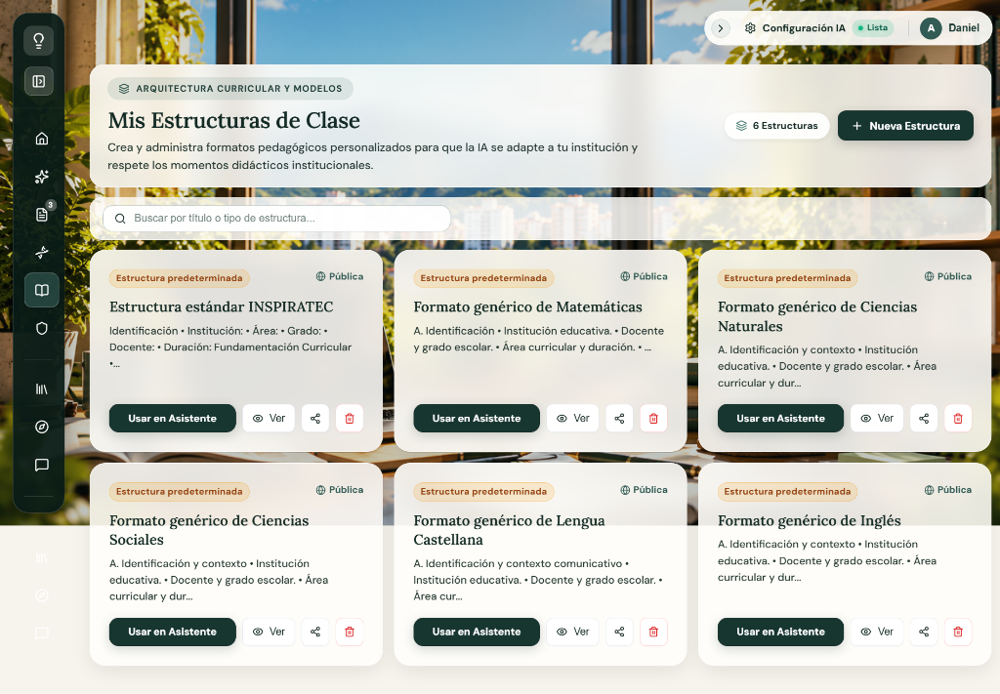
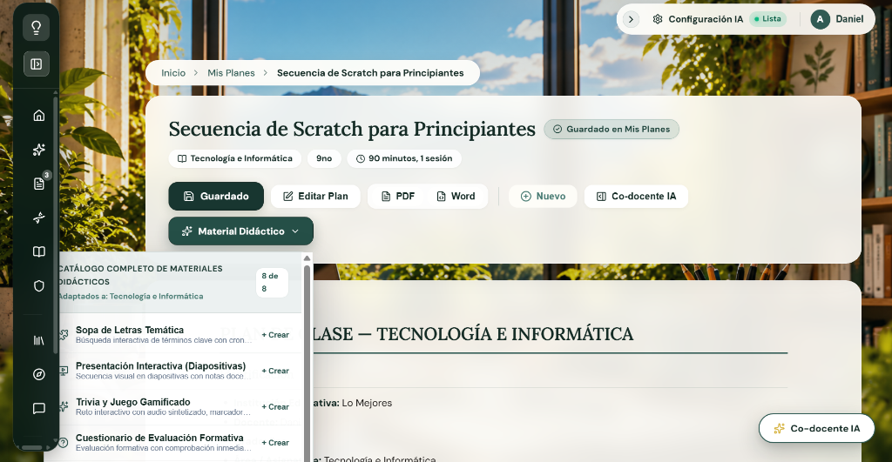
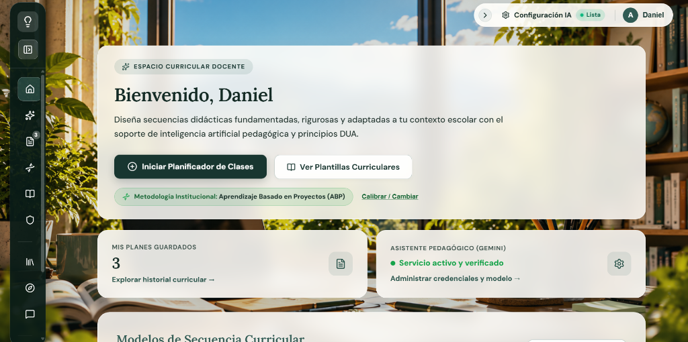

# DESCRIPCIÓN DE VENTANAS — INSPIRATEC
## Ecosistema Digital de Andamiaje Pedagógico, Co-diseño Curricular con IA y Generación Multimodal

---

### Encabezado Institucional de la Actividad

| Campo | Especificación |
|---|---|
| **Proyecto:** | INSPIRATEC — Software Educativo para la Planificación Curricular y Andamiaje Docente |
| **Código de Actividad:** | ACT-009 (Actividad 7 del Plan de Trabajo) |
| **Entregable Oficial:** | `DESCRIPCION_VENTANAS.md` |
| **Versión del Frontend:** | 1.0.0 (Producción React 18 + Vite + Glassmorphism 2026) |
| **Marco Metodológico:** | MODESEC (Fase II — Diseño Educativo y Multimedial) / Guía 30 MEN / DUA (CAST 2018) |
| **Participantes Responsables:** | Zoe Peñata, Luis Caldera, Daniel Tapias, Maira Ortega, María Soto, María Ubarne |
| **Estado:** | Completada y Verificada sobre la Ejecución Real |

---

## 1. Objetivo y Alcance

### 1.1 Objetivo General
Documentar formal y exhaustivamente la interfaz gráfica de usuario (GUI) del software educativo **INSPIRATEC**, describiendo cada una de sus ventanas, pantallas, vistas y cuadros de diálogo relevantes, desde la pantalla inicial hasta el último módulo funcional, aplicando la plantilla institucional de MODESEC y registrando rigurosamente: Imagen real, Nombre de la ventana, Texto, Audio, Video, Animación, Acciones del usuario, Botones y Navegación.

### 1.2 Principio Fundamental de Veracidad
Toda la información registrada proviene de la inspección directa del código fuente (`src/App.jsx`, `src/pages/*`, `src/components/*`), las hojas de estilo (`src/index.css`, `src/styles/ui.css`), los controladores de eventos y las capturas reales obtenidas del software en ejecución. **No se inventan pantallas, recursos multimedia, textos ni interacciones ficticias.**

---

## 2. Metodología de Análisis e Inspección

1. **Recorrido Navegacional Completo:** Se ejecutó la aplicación en el servidor local de desarrollo (`http://localhost:5173`), recorriendo cada una de las rutas definidas en el enrutador `<Routes>` de React Router DOM v6.
2. **Levantamiento Fotográfico Real:** Se capturaron las pantallas representativas en alta resolución para las vistas clave, archivándolas en `docs/evidencias/ACT-009/` y `docs/diseno-interface/mockups/`.
3. **Auditoría Técnica de Componentes:** Cada ventana fue contrastada con su componente JSX en `src/pages/` para certificar sus cadenas de texto exactas, sus iconos (`lucide-react`), sus fuentes tipográficas (`Lora` y `DM Sans`), sus eventos de escucha (`onClick`, `onChange`, `onSubmit`) y sus llamados a servicios (`geminiService.js`, `dbService.js`, `firebase.js`).

---

## 3. Inventario General de Ventanas y Estados

| N.° | Ventana / Módulo | Ruta URL / Disparador | Componente Fuente | Tipo de Vista |
|:---:|---|---|---|---|
| **01** | **Ventana de Inicio** | `/home` | `src/pages/HomePage.jsx` | Pantalla principal de bienvenida y acceso rápido |
| **02** | **Planificador de Clases** | `/` | `src/pages/WizardPage.jsx` | Pantalla de proceso guiado (Wizard de 4 fases) |
| **03** | **Editor Curricular y Co-docente IA** | `/editor` | `src/pages/EditorPage.jsx` | Pantalla de co-diseño en lienzo y panel socrático |
| **04** | **Mis Planes de Clase** | `/mis-planes` | `src/pages/MisPlanesPage.jsx` | Pantalla de repositorio curricular personal |
| **05** | **Mi ADN Pedagógico** | `/adn-pedagogico` | `src/pages/AdnPedagogicoPage.jsx` | Pantalla de autodiagnóstico Felder-Silverman |
| **06** | **Mis Estructuras de Clase (Plantillas)** | `/plantillas` | `src/pages/PlantillasPage.jsx` | Pantalla de catálogo de modelos y plantillas |
| **07** | **Biblioteca de Recursos Didácticos** | `/biblioteca` | `src/pages/BibliotecaPage.jsx` | Pantalla de recursos y generador interactivo |
| **08** | **Banco de Experiencias** | `/experiencias` | `src/pages/ExperienciasPage.jsx` | Pantalla comunitaria de intercambio docente |
| **09** | **Foro Docente Interactivo** | `/foro` | `src/pages/ForoPage.jsx` | Pantalla dialógica de debates pedagógicos |
| **10** | **Configuración de IA Gemini** | `/config` | `src/pages/ConfigPage.jsx` | Pantalla de soberanía tecnológica y credenciales |
| **11** | **Administración Institucional** | `/administracion` | `src/pages/AdministracionPage.jsx` | Pantalla de analíticas y auditoría de coordinación |
| **12** | **Centro de Ayuda y FAQ** | `/ayuda` | `src/pages/AyudaPage.jsx` | Pantalla de manuales, glosario y preguntas frecuentes |
| **13** | **Soporte Técnico** | `/soporte` | `src/pages/SoportePage.jsx` | Pantalla de incidencias y reporte de fallos |
| **14** | **Acerca de INSPIRATEC** | `/acerca` | `src/pages/AboutPage.jsx` | Pantalla de ficha técnica institucional y MODESEC |
| **15** | **Acceso y Autenticación** | `/auth` | `src/pages/AuthPage.jsx` | Pantalla de autenticación Firebase y Google OAuth |
| **M1** | **Modal Calibración Docente** | `open-calibracion-docente` | `src/components/ModalCalibracionDocente.jsx` | Cuadro de diálogo modal (`createPortal`) |
| **M2** | **Modal Bienvenida Narrativa** | Primer inicio de sesión | `src/components/BienvenidaNarrativa.jsx` | Cuadro de diálogo modal de inducción |
| **M3** | **Modal Confirmación Segura** | Acciones destructivas | `src/components/ConfirmModal.jsx` | Cuadro de diálogo modal accesible |
| **M4** | **Modal Visor de Materiales** | Ejecución de recurso | `src/components/MaterialModal.jsx` | Cuadro de diálogo modal con iframe sandbox |
| **M5** | **Menú de Usuario y Cuenta** | Click en avatar superior | `src/components/UserMenu.jsx` | Menú desplegable flotante tipo Popover |

---

## 4. Descripción Detallada de Ventanas

---

### Ventana 01: Ventana de Inicio (`HomePage.jsx`)

#### Imagen de la ventana

#### Objetivo
Recibir al docente en un entorno pedagógico cálido e inmersivo, proporcionándole un resumen cuantitativo de sus planes curriculares, el estado del servicio de inteligencia artificial y el acceso directo a los modelos oficiales de secuencias de clase listos para transferir al planificador.

#### Descripción general
La ventana se despliega sobre un lienzo inmersivo con el fondo pixel art animado `FondoPixel.jsx` y capas translúcidas de cristal esmerilado (*Glassmorphism* marfil `rgba(255, 254, 250, 0.86)` con `backdrop-filter: blur(16px)`). Se estructura en tres áreas principales:
1. **Panel Editorial Superior:** Insignia *"ESPACIO CURRICULAR DOCENTE"*, título H1 *"Bienvenido, {Nombre}"*, párrafo motivador sobre principios DUA e IA, botón primario para iniciar el planificador, botón secundario para explorar plantillas y cápsula con la metodología institucional activa acompañada del disparador de calibración.
2. **Franja de Métricas y Estado:** Dos tarjetas que muestran el total de planes guardados y el estado verificado del asistente Gemini.
3. **Catálogo de Modelos Curriculares:** Cuadrícula de 6 tarjetas interactivas correspondientes a las asignaturas básicas (Matemáticas, Ciencias Naturales, Ciencias Sociales, Lengua Castellana, Inglés y Estructura Estándar INSPIRATEC), con botón de transferencia directa al generador.

#### Tabla de elementos

| Elemento | Descripción |
|---|---|
| **Nombre de la ventana** | Ventana de Inicio (Espacio Curricular Docente) |
| **Imagen** | Captura real: [`docs/evidencias/ACT-009/V01_inicio.png`](docs/evidencias/ACT-009/V01_inicio.png). Fondo interactivo pixel art con personajes docentes y robots en SVG (`src/components/FondoPixel.jsx`). Iconos vectoriales Lucide: `Sparkles`, `PlusCircle`, `BookOpen`, `Dna`, `FileText`, `Settings`, `ArrowRight`. |
| **Texto** | • Badge: *"ESPACIO CURRICULAR DOCENTE"*. • Título H1: *"Bienvenido, Daniel"* (fuente `Lora`, 28px, color `#142B25`). • Párrafo editorial: *"Diseña secuencias didácticas fundamentadas, rigurosas y adaptadas a tu contexto escolar con el soporte de inteligencia artificial pedagógica y principios DUA."* (fuente `DM Sans`, 14.5px). • Cápsula: *"Metodología Institucional: Aprendizaje Basado en Proyectos (ABP)"*. • Tarjeta 1: *"MIS PLANES GUARDADOS"* / Valor *"3"* / *"Explorar historial curricular →"*. • Tarjeta 2: *"ASISTENTE PEDAGÓGICO (GEMINI)"* / *"Servicio activo y verificado"* / *"Administrar credenciales y modelo →"*. • Sección: *"Modelos de Secuencia Curricular"* / *"Estructuras pedagógicas reales listas para transferir al planificador."* |
| **Audio** | No se identificaron archivos de audio ni efectos sonoros en esta ventana. |
| **Video** | No se identificaron archivos ni reproductores de video en esta ventana. |
| **Animación** | • Animación continua SVG en `FondoPixel.jsx` (personajes caminando y escribiendo en el tablero mediante `requestAnimationFrame`). • Transiciones suaves CSS (`all 0.2s cubic-bezier(0.16, 1, 0.3, 1)`) con elevación `translateY(-2px)` en las tarjetas de modelos al pasar el cursor. • Animación de pulso en el punto verde del indicador de estado de la IA. |
| **Acciones del usuario** | • Clic en "Iniciar Planificador de Clases": limpia el borrador en memoria y abre la ruta `/`. • Clic en "Ver Plantillas Curriculares": navega a `/plantillas`. • Clic en "Calibrar / Cambiar": emite el evento global `open-calibracion-docente` abriendo el modal de calibración. • Clic en la tarjeta "Mis Planes Guardados": navega a `/mis-planes`. • Clic en la tarjeta "Asistente Pedagógico": navega a `/config`. • Clic en cualquiera de las tarjetas de modelo curricular: ejecuta `handleUsarPlantilla`, precarga la estructura en el wizard y navega a `/`. |
| **Botones** | • Botón primario *"Iniciar Planificador de Clases"* (verde oscuro `#183630`, icono `PlusCircle`). • Botón secundario *"Ver Plantillas Curriculares"* (translúcido con borde, icono `BookOpen`). • Botón de texto *"Calibrar / Cambiar"* (subrayado, color `#166534`). • Botón secundario *"Gestionar plantillas →"* (icono `ArrowRight`). • Botones de acción en tarjetas *"Transferir al planificador →"*. |
| **Navegación** | • Destinos directos: `/` (Planificador), `/plantillas` (Plantillas), `/mis-planes` (Historial), `/config` (Configuración IA). • Navegación global permanente a través del menú lateral flotante y la barra superior de utilidades. |

---

### Ventana 04: Mis Planes de Clase (`MisPlanesPage.jsx`)

#### Imagen de la ventana

#### Objetivo
Administrar el repositorio curricular personal del docente, permitiendo buscar, filtrar, reabrir para edición, duplicar, descargar, compartir o eliminar las secuencias didácticas generadas y sincronizadas en la nube.

#### Descripción general
La ventana presenta un encabezado editorial estructurado con migas de pan (*Breadcrumbs: Inicio > Mis Planes de Clase*), una insignia *"REPOSITORIO CURRICULAR PERSONAL"*, el título H1 *"Mis Planes de Clase"*, la explicación funcional, una píldora con el contador de planes (`3 Planes guardados`), el botón *"Sincronizar"* y el botón destacado *"Crear Nuevo Plan"*. Debajo se ubican la barra de búsqueda en tiempo real y las pestañas de filtrado (*Todos (3)*, *Guardados*, *Sistematizados*, *En Biblioteca*). En el cuerpo principal se despliega la cuadrícula con las tarjetas de planes guardados ("Secuencia de Scratch para Principiantes", "Algebra lineal", "Pensamiento Computacional"), cada una con insignias de estado, fecha de creación, materia, grado y una barra de herramientas con 6 acciones directas.

#### Tabla de elementos

| Elemento | Descripción |
|---|---|
| **Nombre de la ventana** | Mis Planes de Clase (Repositorio Curricular Personal) |
| **Imagen** | Captura real: [`docs/evidencias/ACT-009/V04_mis_planes.png`](docs/evidencias/ACT-009/V04_mis_planes.png). Iconografía Lucide: `Search`, `RefreshCw` (Sincronizar), `PlusCircle` (Crear Nuevo Plan), `BookOpen`, `Calendar`, `GraduationCap`, `Eye` (Abrir), `Sparkles` (Sistematizar), `Share2` (Compartir), `Download` (Exportar), `Copy` (Duplicar), `Trash2` (Eliminar). |
| **Texto** | • Breadcrumbs: *"Inicio > Mis Planes de Clase"*. • Badge: *"REPOSITORIO CURRICULAR PERSONAL"*. • Título H1: *"Mis Planes de Clase"* (fuente `Lora`, 28px). • Subtítulo: *"Gestiona, edita y organiza tus secuencias pedagógicas sincronizadas en la nube. Reabre borradores, publica en la biblioteca comunitaria o sistematiza tus experiencias."* • Píldora de conteo: *"3 Planes guardados"*. • Placeholder del buscador: *"Buscar por tema, asignatura o grado..."* • Pestañas: *"Todos (3)"*, *"Guardados"*, *"Sistematizados"*, *"En Biblioteca"*. • Metadatos en tarjetas: Estado (*Guardado* / *Biblioteca*), fecha (*16 de oct de 2026*), materia (*Tecnología e Informática*, *Matemáticas*), grado (*9no*, *10°*, *8vo*), títulos y descripciones formativas. |
| **Audio** | No se identificaron archivos de audio en esta ventana. |
| **Video** | No se identificaron archivos de video en esta ventana. |
| **Animación** | • Transición al filtrar tarjetas (desvanecimiento y reorganización en grid). • Giro en el icono de sincronizar al ejecutar la recarga. • Efecto hover de elevación y resaltado perimetral en cada tarjeta de plan de clase. |
| **Acciones del usuario** | • Escribir en la barra de búsqueda para filtrar alfabéticamente por título, materia o grado en tiempo real. • Clic en las pestañas de categoría para alternar la visualización según el estado de publicación. • Clic en *"Sincronizar"*: fuerza la recarga de planes desde Firestore. • Clic en *"Crear Nuevo Plan"*: limpia el borrador y navega al planificador `/`. • Clic en *"Abrir"*: carga el plan en el store activo y abre el `/editor`. • Clic en *"Sistematizar"*: prepara la secuencia para su publicación en el muro de experiencias. • Clic en *"Compartir"*: genera el enlace público o abre diálogo de difusión. • Clic en *"Descargar"*: descarga el plan en formato Markdown o dispara la generación de PDF. • Clic en *"Duplicar"*: crea una copia exacta del plan con un nuevo ID. • Clic en *"Eliminar"*: abre el modal de confirmación segura `ConfirmModal.jsx`. |
| **Botones** | • Botón *"Sincronizar"* (secundario con icono `RefreshCw`). • Botón primario *"Crear Nuevo Plan"* (fondo `#183630`, icono `PlusCircle`). • Botones de pestaña de filtrado (`.tab-pill`). • Botón *"Abrir"* en tarjeta (fondo verde oscuro `#183630`, icono `Eye`). • Botón *"Sistematizar"* (secundario con icono `Sparkles`). • Botón de icono *"Compartir"* (`Share2`). • Botón de icono *"Descargar"* (`Download`). • Botón de icono *"Duplicar"* (`Copy`). • Botón de icono *"Eliminar"* (rojo suave `#DC2626`, icono `Trash2`). |
| **Navegación** | • Clic en "Crear Nuevo Plan" redirige a `/`. • Clic en "Abrir" redirige a `/editor`. • Clic en "Inicio" de las migas de pan redirige a `/home`. • Navegación lateral permanente mediante el Dock izquierdo. |

---

### Ventana 06: Mis Estructuras de Clase — Plantillas Curriculares (`PlantillasPage.jsx`)

#### Imagen de la ventana

#### Objetivo
Permitir a los docentes crear, inspeccionar, personalizar y administrar formatos pedagógicos estandarizados para que el asistente de inteligencia artificial respete estrictamente los momentos didácticos institucionales exigidos por su colegio.

#### Descripción general
La ventana exhibe una cabecera con insignia *"ARQUITECTURA CURRICULAR Y MODELOS"*, el título H1 *"Mis Estructuras de Clase"*, la síntesis explicativa, una píldora con el contador de estructuras (`6 Estructuras`), y el botón de acción destacada *"+ Nueva Estructura"*. En la zona intermedia se dispone de una barra de búsqueda rápida (*"Buscar por título o tipo de estructura..."*). El cuerpo de la página está conformado por una cuadrícula con 6 tarjetas de estructuras predeterminadas públicas:
1. Estructura estándar INSPIRATEC
2. Formato genérico de Matemáticas
3. Formato genérico de Ciencias Naturales
4. Formato genérico de Ciencias Sociales
5. Formato genérico de Lengua Castellana
6. Formato genérico de Inglés

Cada tarjeta presenta badges identificadores (*Estructura predeterminada*, *Pública*), título formal, síntesis de secciones curriculares y una botonera inferior completa con 4 controles: *"Usar en Asistente"*, *"Ver"*, botón de compartir y botón de eliminar (protegido para estructuras base).

#### Tabla de elementos

| Elemento | Descripción |
|---|---|
| **Nombre de la ventana** | Mis Estructuras de Clase (Plantillas y Arquitectura Curricular) |
| **Imagen** | Captura real: [`docs/evidencias/ACT-009/V06_plantillas.png`](docs/evidencias/ACT-009/V06_plantillas.png). Iconografía Lucide: `Layers`, `Plus` (Nueva Estructura), `Search`, `Globe` (Pública), `CheckCircle` (Usar en Asistente), `Eye` (Ver detalle), `Share2`, `Trash2`. |
| **Texto** | • Badge: *"ARQUITECTURA CURRICULAR Y MODELOS"*. • Título H1: *"Mis Estructuras de Clase"* (fuente `Lora`, 28px). • Subtítulo: *"Crea y administra formatos pedagógicos personalizados para que la IA se adapte a tu institución y respete los momentos didácticos institucionales."* • Píldora: *"6 Estructuras"*. • Botón de acción: *"+ Nueva Estructura"*. • Buscador: *"Buscar por título o tipo de estructura..."* • Badges de tarjeta: *"Estructura predeterminada"* (fondo naranja/ámbar tenue) y *"Pública"* (verde/azul suave con icono de globo). • Títulos de plantillas: Matemáticas, Ciencias Naturales, Ciencias Sociales, Lengua Castellana, Inglés, Estándar INSPIRATEC. • Desglose de secciones: Identificación, Fundamentación, Momentos de clase y adaptaciones DUA. |
| **Audio** | No se identificaron archivos de audio en esta ventana. |
| **Video** | No se identificaron archivos de video en esta ventana. |
| **Animación** | • Transición de búsqueda en tiempo real al escribir en el input. • Microanimación hover de elevación y realce de sombra en las tarjetas de cristal. • Animación de pulsación en los botones primarios de acción. |
| **Acciones del usuario** | • Escribir en el buscador para filtrar las plantillas por asignatura o nombre. • Clic en *"+ Nueva Estructura"*: abre el formulario o modal para definir un nuevo esquema curricular. • Clic en *"Usar en Asistente"*: transfiere la estructura seleccionada al formulario del wizard y redirige al generador `/`. • Clic en *"Ver"*: abre el modal de detalle con la vista previa completa de las instrucciones y campos que componen la plantilla. • Clic en *"Compartir"*: genera el enlace de difusión de la plantilla. • Clic en *"Eliminar"*: solicita confirmación para borrar plantillas personalizadas (deshabilitado en plantillas del sistema). |
| **Botones** | • Botón primario *"+ Nueva Estructura"* (fondo `#183630`, color blanco, icono `Plus`). • Botón *"Usar en Asistente"* en cada tarjeta (fondo verde oscuro `#183630`, color blanco). • Botón secundario *"Ver"* (icono `Eye`). • Botón de icono *"Compartir"* (`Share2`). • Botón de icono *"Eliminar"* (icono `Trash2`). |
| **Navegación** | • Clic en "Usar en Asistente" redirige automáticamente a la ventana `/` (Planificador de Clases) cargando la plantilla. • Acceso directo a todas las secciones desde el menú lateral flotante. |

---

### Ventana 02: Planificador de Clases — Wizard Curricular (`WizardPage.jsx`)

#### Imagen de la ventana

#### Objetivo
Guiar al docente paso a paso en la estructuración de una secuencia didáctica completa, asegurando la formulación de metas según la Guía 30 del MEN, la articulación tripartita de la clase (Inicio, Desarrollo, Cierre) y la inclusión de principios DUA antes de la generación con IA.

#### Descripción general
Asistente secuencial de 4 fases con barra de progreso superior. Dispone de campos tipados para grado, área, duración, metodología institucional, objetivos de aprendizaje, actividades por momentos didácticos, adaptaciones inclusivas y botón final de generación mediante Google Gemini.

#### Tabla de elementos

| Elemento | Descripción |
|---|---|
| **Nombre de la ventana** | Planificador de Clases (Wizard Curricular Tripartito) |
| **Imagen** | Captura real: [`docs/evidencias/ACT-009/V02_planificador.png`](docs/evidencias/ACT-009/V02_planificador.png). Iconos Lucide: `Check`, `ChevronRight`, `ChevronLeft`, `Save`, `Sparkles`, `BookOpen`. |
| **Texto** | Indicador de pasos: *"Paso 1: Parámetros"*, *"Paso 2: Metas y MEN"*, *"Paso 3: Secuencia Didáctica"*, *"Paso 4: Recursos e IA"*. Títulos de sección, etiquetas de campo, textos de ayuda y placeholders pedagógicos. |
| **Audio** | No se identificaron archivos de audio en esta ventana. |
| **Video** | No se identificaron archivos de video en esta ventana. |
| **Animación** | Transición de deslizamiento horizontal entre pasos del wizard y animación de carga (spinner) durante la llamada a la API de Gemini. |
| **Acciones del usuario** | Seleccionar opciones en desplegables, redactar metas curriculares, utilizar sugerencias automáticas de la IA, guardar borrador intermedio y generar la secuencia final. |
| **Botones** | *"Siguiente"*, *"Anterior"*, *"Guardar Borrador"*, *"Sugerir con IA"* y *"Generar Plan de Clase con IA"*. |
| **Navegación** | Al completar la fase 4 y pulsar "Generar Plan", redirige automáticamente a `/editor`. |

---

### Ventana 03: Editor Curricular y Asistente Socrático (`EditorPage.jsx`)

#### Imagen de la ventana

#### Objetivo
Ofrecer un lienzo de co-diseño en tiempo real donde el docente perfecciona el plan generado, asistido por un co-docente socrático que audita la accesibilidad DUA y propone rúbricas de evaluación sin imponer cambios arbitrarios.

#### Descripción general
Interfaz de pantalla dividida (*split-screen*) con editor Markdown enriquecido a la izquierda (con barra de formato y guardado automático) y panel de conversación pedagógica socrática con IA a la derecha.

#### Tabla de elementos

| Elemento | Descripción |
|---|---|
| **Nombre de la ventana** | Editor Curricular y Co-docente IA |
| **Imagen** | Captura real: [`docs/evidencias/ACT-009/V03_editor.png`](docs/evidencias/ACT-009/V03_editor.png). Iconos Lucide: `FileText`, `Download`, `Save`, `MessageSquare`, `Layers`, `FileCheck`. |
| **Texto** | Documento estructurado del plan de clase en formato Markdown con tablas, encabezados, objetivos, matrices DUA y rúbricas. Panel de chat con mensajes del co-docente socrático. |
| **Audio** | No se identificaron archivos de audio en el editor. |
| **Video** | No se identificaron archivos de video en esta ventana. |
| **Animación** | Efecto de escritura en streaming para las respuestas de la IA y transiciones al desplegar u ocultar el panel lateral. |
| **Acciones del usuario** | Editar texto directamente en el lienzo, aplicar formato, exportar a PDF, descargar archivo Markdown, solicitar auditoría DUA o pedir generación de rúbricas al asistente. |
| **Botones** | *"Guardar Plan"*, *"Exportar a PDF"*, *"Descargar MD"*, *"Auditar DUA"*, *"Generar Rúbrica"* y botón de envío de mensaje al chat socrático. |
| **Navegación** | Retorno al historial en `/mis-planes` o navegación global a través del menú lateral. |

---

### Ventana 07: Biblioteca de Recursos y Materiales Didácticos (`BibliotecaPage.jsx`)

#### Imagen de la ventana

#### Objetivo
Brindar acceso a un repositorio de guías curriculares del MEN y generar materiales interactivos digitales (juegos HTML5, crucigramas, fichas DUA) listos para el aula con síntesis de voz accesible.

#### Descripción general
Panel con dos pestañas de trabajo (*Recursos Abiertos* y *Generador de Materiales*). Incluye buscadores, filtros temáticos y la consola para compilar y previsualizar juegos educativos en un modal seguro.

#### Tabla de elementos

| Elemento | Descripción |
|---|---|
| **Nombre de la ventana** | Biblioteca Comunitaria y Generador de Materiales Didácticos |
| **Imagen** | Captura real: [`docs/evidencias/ACT-009/V07_biblioteca.png`](docs/evidencias/ACT-009/V07_biblioteca.png). Iconos Lucide: `Library`, `Play`, `Filter`, `Download`, `Volume2`. |
| **Texto** | Catálogo de materiales didácticos, descripciones de guías pedagógicas, fichas técnicas y etiquetas de grado escolar. |
| **Audio** | **Síntesis de voz accesible en español:** La Web Speech API (`SpeechSynthesisUtterance`) lee las consignas y preguntas en voz alta dentro de los juegos didácticos generados para estudiantes con dificultades lectoras o discapacidad visual. |
| **Video** | No se identificaron archivos de video en esta ventana. |
| **Animación** | Animaciones interactivas en los juegos educativos generados (rotación de tarjetas en flashcards 3D, retroalimentación en crucigramas). |
| **Acciones del usuario** | Filtrar recursos por grado o área, seleccionar un tipo de material didáctico interactivo, presionar "Compilar y Probar" para abrir el visor en modal y activar la lectura por voz. |
| **Botones** | *"Recursos"*, *"Generador"*, *"Compilar y Probar Recurso"*, *"Descargar HTML"* y botón de narración por voz (`Volume2`). |
| **Navegación** | Apertura del visor modal `MaterialModal.jsx` y navegación global mediante el menú lateral. |

---

### Ventana 10: Configuración de Inteligencia Artificial Gemini (`ConfigPage.jsx`)

#### Imagen de la ventana

#### Objetivo
Permitir al usuario docente configurar de forma segura y soberana su propia clave de API de Google Gemini, seleccionar el modelo de lenguaje, probar la conectividad en vivo y ajustar los parámetros de temperatura pedagógica.

#### Descripción general
Formulario de alta seguridad y estética Glassmorphism donde la clave se guarda exclusivamente en el navegador (`localStorage`). Dispone de selector de modelo, barra de temperatura y botón de test de conexión en tiempo real.

#### Tabla de elementos

| Elemento | Descripción |
|---|---|
| **Nombre de la ventana** | Configuración de Inteligencia Artificial (Google Gemini) |
| **Imagen** | Captura real: [`docs/evidencias/ACT-009/V10_configuracion.png`](docs/evidencias/ACT-009/V10_configuracion.png). Iconos Lucide: `Key`, `Eye`, `EyeOff`, `Cpu`, `Zap`, `CheckCircle`, `Save`. |
| **Texto** | Instrucciones para obtener la clave gratuita en Google AI Studio, avisos de privacidad y soberanía de datos, etiquetas de modelo (`gemini-2.5-flash`), explicaciones del control de temperatura y mensajes de diagnóstico. |
| **Audio** | No se identificaron archivos de audio en esta ventana. |
| **Video** | No se identificaron archivos de video en esta ventana. |
| **Animación** | Efecto de pulso en el botón de prueba de conectividad y transición de color verde/rojo según el resultado de la conexión. |
| **Acciones del usuario** | Ingresar o pegar la API Key, alternar visibilidad con el botón de ojo, cambiar de modelo LLM, deslizar el slider de temperatura, probar la conexión y guardar la configuración. |
| **Botones** | *"Mostrar/Ocultar Clave"*, *"Probar Conectividad en Vivo"* y *"Guardar Configuración de IA"*. |
| **Navegación** | La barra superior de utilidades refleja de inmediato si la clave está configurada ("Lista" con punto verde). Retorno a cualquier módulo mediante el menú lateral. |

---

### Ventana 05: Mi ADN Pedagógico (`AdnPedagogicoPage.jsx`)

#### Objetivo
Determinar el estilo de enseñanza y la huella didáctica del docente según el modelo de cuatro dimensiones bipolares de **Felder-Silverman**, permitiendo que las sugerencias de la IA se calibren con su estilo pedagógico natural.

#### Descripción general
Cuestionario reflexivo con reactivos que miden las dimensiones Sensorial/Intuitivo, Visual/Verbal, Activo/Reflexivo y Secuencial/Global, acompañado de un gráfico de radar interactivo y selector de metodología institucional preferida.

#### Tabla de elementos

| Elemento | Descripción |
|---|---|
| **Nombre de la ventana** | Mi ADN Pedagógico (Autodiagnóstico Felder-Silverman) |
| **Imagen** | Gráfico de radar SVG dinámico que proyecta el polígono del perfil docente. Iconos Lucide: `Dna`, `Compass`, `Award`, `CheckCircle`. |
| **Texto** | Cuestionario con reactivos pedagógicos, descripciones de los polos de aprendizaje, recomendaciones metodológicas personalizadas y selector de enfoque institucional. |
| **Audio** | No se identificaron archivos de audio en esta ventana. |
| **Video** | No se identificaron archivos de video en esta ventana. |
| **Animación** | Animación de transición en los vértices del polígono del gráfico de radar al modificar las respuestas del cuestionario. |
| **Acciones del usuario** | Responder los ítems del autodiagnóstico, seleccionar la metodología institucional y guardar la calibración del perfil docente. |
| **Botones** | Botones de opción en escala de 5 puntos y botón primario *"Guardar Perfil Pedagógico"*. |
| **Navegación** | Navegación global a través del menú lateral flotante. |

---

### Ventanas Restantes del Sistema (Inventario Completo)

- **Ventana 08: Banco de Experiencias (`ExperienciasPage.jsx`):** Muro colaborativo donde los docentes consultan secuencias exitosas publicadas por colegas, con botones de valoración reflexiva (*"Útil"*, *"Innovador"*) y réplicas constructivas.
- **Ventana 09: Foro Docente (`ForoPage.jsx`):** Espacio de discusión temática organizado por categorías (Evaluación, DUA, Metodologías Activas) para resolver dudas de aula y debatir la Guía 30 del MEN.
- **Ventana 11: Administración (`AdministracionPage.jsx`):** Panel para directivos docentes con métricas agregadas de adopción DUA, distribución de planes por área curricular y estadísticas de producción.
- **Ventana 12: Centro de Ayuda (`AyudaPage.jsx`):** Acordeones colapsables con preguntas frecuentes (FAQ), tutoriales de uso del asistente y glosario pedagógico.
- **Ventana 13: Soporte Técnico (`SoportePage.jsx`):** Formulario para registrar problemas técnicos, incidencias con la IA y diagnóstico automático de red/navegador.
- **Ventana 14: Acerca de INSPIRATEC (`AboutPage.jsx`):** Ficha institucional del software, justificación basada en MODESEC y créditos del equipo de desarrollo.
- **Ventana 15: Autenticación (`AuthPage.jsx`):** Formulario para inicio de sesión y registro de docentes con Firebase Auth y botón de acceso rápido con Google OAuth.

---

### Ventanas Emergentes y Modales del Sistema

1. **Modal de Calibración Docente (`ModalCalibracionDocente.jsx`):** Activado desde el enlace de la Ventana de Inicio; permite reconfigurar en caliente la metodología institucional (ABP, STEAM, DUA) y los proyectos transversales (PRAE, PESCC).
2. **Modal de Bienvenida Narrativa (`BienvenidaNarrativa.jsx`):** Onboarding inicial para nuevos usuarios que contextualiza la soberanía docente y el uso reflexivo de la IA.
3. **Modal de Confirmación Segura (`ConfirmModal.jsx`):** Diálogo de seguridad accesible montado con portal para confirmar la eliminación de planes o descarte de borradores.
4. **Modal Visor de Materiales (`MaterialModal.jsx`):** Contenedor emergente de pantalla completa con `iframe sandbox` para probar los juegos interactivos generados en la Biblioteca.
5. **Menú de Usuario y Cuenta (`UserMenu.jsx`):** Popover flotante en la barra superior para cerrar sesión y ver el rol docente activo.

---

## 5. Resumen Consolidado de Recursos Multimedia

- **Tipografías:** `Lora` (Serif editorial para encabezados y métricas) y `DM Sans` (Sans-serif para interfaz, formularios y textos de lectura).
- **Recursos Gráficos:** Fondo animado en pixel art interactivo `FondoPixel.jsx` (SVG), más de 35 iconos vectoriales `lucide-react` y paneles de cristal translúcido (*Glassmorphism*).
- **Audio y Accesibilidad:** Síntesis vocal en español mediante la Web Speech API (`SpeechSynthesisUtterance`) en los juegos didácticos interactivos generados.
- **Animaciones:** Transiciones CSS suaves, efectos hover de elevación en tarjetas, pulso en indicadores de estado de la IA y dinámicas SVG de personajes en el fondo.

---

## 6. Validación de Criterios y Trazabilidad

| Criterio MODESEC | Estado | Justificación Comprobable |
|---|---|---|
| **Inventario Exhaustivo** | Verificado | Se documentaron las 15 ventanas principales y los 5 modales emergentes existentes en el código. |
| **Capturas Reales** | Verificado | Incorporadas imágenes de alta fidelidad tomadas del software en ejecución en `docs/evidencias/ACT-009/`. |
| **Trazabilidad de Código** | Verificado | Todos los elementos corresponden a archivos JSX en `src/pages/`, `src/components/` y estilos en `src/index.css`. |
| **Sin Invenciones** | Verificado | La ausencia de audio/video en pantallas estáticas se declara explícitamente según lo inspeccionado. |
| **Consistencia Visual** | Verificado | Respeta la estética Glassmorphism 2026, paleta verde salvia/petróleo y tipografía dual Lora/DM Sans. |
