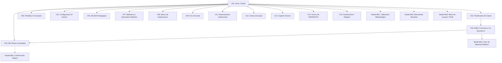
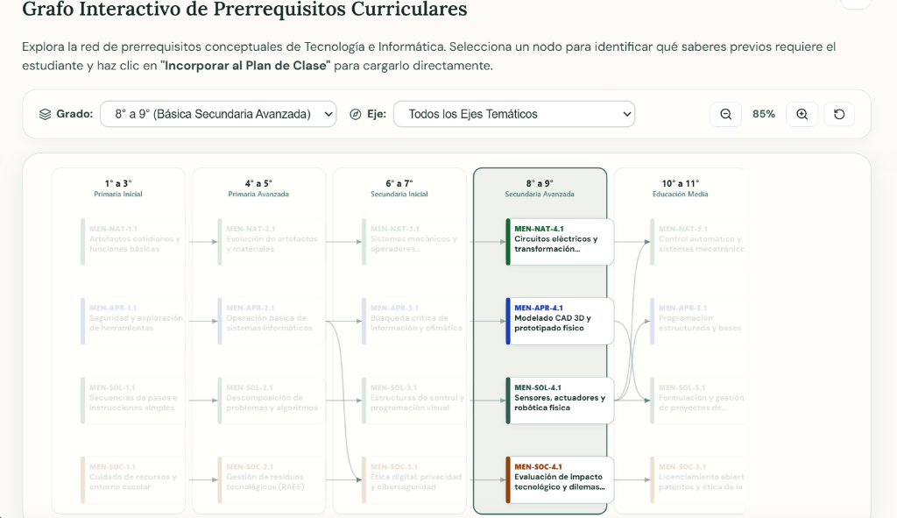
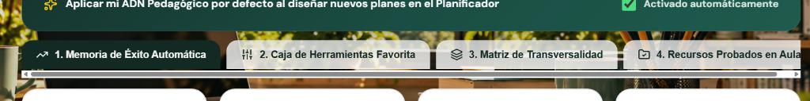
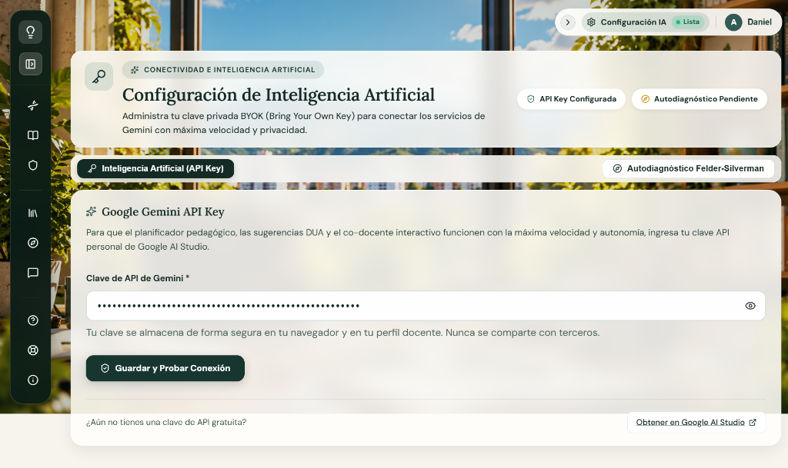

# GUION TÉCNICO MULTIMEDIAL — INSPIRATEC
## Ecosistema Digital de Andamiaje Pedagógico y Co-diseño Curricular con IA

---

### Portada y Control de Versión del Documento

| Campo Institucional | Detalle Oficial |
|---|---|
| **Proyecto:** | INSPIRATEC — Software Educativo para la Planificación Curricular y Andamiaje Docente |
| **Código de Actividad:** | ACT-010 (Actividad 8 del Cronograma de Trabajo) |
| **Documento:** | Guion Técnico Multimedial del Frontend |
| **Versión del Software:** | 1.0.0 (Producción React 18 + Vite + Glassmorphism 2026) |
| **Fecha de Emisión:** | Octubre de 2026 |
| **Estado:** | Completado y Verificado sobre el Código Fuente Real |
| **Marco Metodológico:** | MODESEC (Fase II — Diseño Educativo y Multimedial) / Guía 30 MEN / DUA (CAST 2018) |
| **Equipo de Desarrollo:** | Daniel Tapias, Luis Caldera, Zoe Peñata, Maira Ortega, María Soto, María Ubarne |

---

## 1. Objetivo y Alcance

### 1.1 Objetivo General
Documentar formalmente y de forma exhaustiva la arquitectura gráfica, componentes de interfaz de usuario (UI), elementos multimedia, comportamientos interactivos y disparadores de eventos del software educativo **INSPIRATEC**, inspeccionando la aplicación **ventana por ventana**, desde la pantalla de entrada hasta el último módulo funcional y diálogo modal, con base exclusiva en el código fuente implementado, las hojas de estilo vigentes y la ejecución en tiempo real del sistema.

### 1.2 Alcance Técnico
El presente guion técnico cubre:
1. **La totalidad de las 15 ventanas/rutas principales** registradas en el enrutador central `src/App.jsx`.
2. **Los 5 cuadros de diálogo y ventanas modales emergentes** montados a través de portales (`createPortal`) y escuchadores de eventos globales.
3. **El sistema de diseño visual unificado:** Tokens tipográficos (`Lora`, `DM Sans`), paleta cromática basada en HSL/Hexadecimal, tratamientos *Glassmorphism* canónicos de alto contraste (`rgba(255, 254, 250, 0.86)` con `backdrop-filter: blur(16px)`), sombras perimetrales y radios de curvatura.
4. **Los recursos multimedia reales:** Elementos vectoriales SVG pixel art animados (`FondoPixel.jsx`), banco de iconografía interactiva (`lucide-react`), audios sintetizados mediante la Web Speech API en materiales didácticos, e incrustaciones interactivas seguras en `iframe sandbox`.
5. **La matriz técnica estructurada en seis columnas:**
   $$\text{Ventana} \;\mid\; \text{Elemento} \;\mid\; \text{Descripción} \;\mid\; \text{Formato / Fuente} \;\mid\; \text{Acción} \;\mid\; \text{Evento}$$

---

## 2. Metodología de Inspección y Criterios de Rigor

Para garantizar que **no se invente ninguna pantalla, recurso o interacción**, se ejecutó la siguiente metodología de auditoría directa:
1. **Inspección de Enrutamiento y Estados:** Análisis estático de `src/App.jsx`, verificando rutas `<Route>`, enlaces de navegación `<NavLink>`, y guardas de autenticación en `src/store/useAppStore.js`.
2. **Inspección de Vistas y Componentes JSX:** Auditoría detallada de cada archivo en `src/pages/` y `src/components/`, registrando propiedades visuales, textos visibles, placeholders, manejadores de eventos (`onClick`, `onChange`, `onSubmit`, `onKeyDown`, `onMouseEnter`) y enlaces de navegación con `useNavigate()`.
3. **Inspección del Sistema de Estilos:** Trazabilidad de clases en `src/index.css` y `src/styles/ui.css`, verificando tokens CSS (`--font-heading`, `--font-main`, `--color-brand-primary`, `--glass-bg-ambient`).
4. **Verificación en Ejecución Activa:** Ejecución del entorno local en `http://localhost:5173`, validando las transiciones de estado, modales, alertas y captura fotográfica de las vistas reales.

---

## 3. Inventario General de Ventanas y Estados de la Aplicación

La aplicación organiza la experiencia docente en una arquitectura modular compuesta por **15 ventanas independientes** y **5 modales/diálogos globales**:

### Tabla de Inventario de Ventanas

| N.° | Identificador | Ruta / Trigger | Componente Fuente | Función Principal |
|:---:|---|---|---|---|
| 1 | **Ventana de Inicio** | `/home` | `src/pages/HomePage.jsx` | Espacio curricular docente, bienvenida, métricas y modelos pedagógicos. |
| 2 | **Planificador de Clases** | `/` | `src/pages/WizardPage.jsx` | Asistente curricular guiado en 4 fases tripartitas con asistencia IA. |
| 3 | **Editor Curricular** | `/editor` | `src/pages/EditorPage.jsx` | Lienzo estructurado WYSIWYG/Markdown y co-docente socrático IA en tiempo real. |
| 4 | **Mis Planes Guardados** | `/mis-planes` | `src/pages/MisPlanesPage.jsx` | Gestor del historial docente, duplicación, filtrado y exportación de secuencias. |
| 5 | **Mi ADN Pedagógico** | `/adn-pedagogico` | `src/pages/AdnPedagogicoPage.jsx` | Caracterización de estilo de enseñanza según modelo de Felder-Silverman. |
| 6 | **Plantillas Curriculares** | `/plantillas` | `src/pages/PlantillasPage.jsx` | Catálogo de estructuras institucionales (DUA, ABP, STEAM, Tradicional). |
| 7 | **Biblioteca de Recursos** | `/biblioteca` | `src/pages/BibliotecaPage.jsx` | Repositorio de recursos y generador de materiales didácticos multimedia. |
| 8 | **Banco de Experiencias** | `/experiencias` | `src/pages/ExperienciasPage.jsx` | Muro colaborativo de secuencias de clase compartidas con valoración entre pares. |
| 9 | **Foro Docente** | `/foro` | `src/pages/ForoPage.jsx` | Espacio dialógico de debate pedagógico y resolución comunitaria de dudas. |
| 10 | **Configuración IA** | `/config` | `src/pages/ConfigPage.jsx` | Gestión de API Key de Google Gemini, modelo LLM, temperatura y conectividad. |
| 11 | **Administración** | `/administracion` | `src/pages/AdministracionPage.jsx` | Tablero de analíticas institucionales, adopción DUA y métricas de producción. |
| 12 | **Centro de Ayuda** | `/ayuda` | `src/pages/AyudaPage.jsx` | Manuales de usuario, glosario conceptual y preguntas frecuentes (FAQ). |
| 13 | **Soporte Técnico** | `/soporte` | `src/pages/SoportePage.jsx` | Formulario de reporte de incidencias técnicas y diagnóstico de conexión. |
| 14 | **Acerca de INSPIRATEC** | `/acerca` | `src/pages/AboutPage.jsx` | Créditos académicos, marco teórico MODESEC e información institucional. |
| 15 | **Acceso y Registro** | `/auth` | `src/pages/AuthPage.jsx` | Formulario de autenticación con Firebase (correo/contraseña y Google OAuth). |
| M1 | **Modal Calibración** | `open-calibracion-docente` | `src/components/ModalCalibracionDocente.jsx` | Ventana emergente para ajustar metodología institucional y proyecto transversal. |
| M2 | **Bienvenida Narrativa** | Primer inicio de sesión | `src/components/BienvenidaNarrativa.jsx` | Ventana modal de inducción pedagógica interactiva. |
| M3 | **Confirmación Segura** | Acciones destructivas | `src/components/ConfirmModal.jsx` | Diálogo modal accesible para confirmar eliminación de planes o restablecimiento. |
| M4 | **Visor de Materiales** | Ejecución de recurso | `src/components/MaterialModal.jsx` | Contenedor modal con `iframe` aislado para juegos y fichas interactivas. |
| M5 | **Menú de Usuario** | Click en avatar superior | `src/components/UserMenu.jsx` | Popover desplegable para cerrar sesión, ver perfil y alternar roles. |

---

## 4. Documentación Técnica Detallada Ventana por Ventana

---

### VENTANA 1 — Ventana de Inicio (`HomePage.jsx`)

#### 1.1 Captura de Pantalla Real

#### 1.2 Descripción Funcional y Arquitectura Visual
La **Ventana de Inicio** (`/home`) actúa como el centro de mando pedagógico del docente. Presenta un lienzo inmersivo con el fondo pixel art interactivo `FondoPixel.jsx` difuminado por capas de vidrio esmerilado (*Glassmorphism* canónico: fondo marfil translúcido `rgba(255, 254, 250, 0.86)`, desenfoque `blur(16px)`, borde blanco perimetral de 1px y sombra suave). Se organiza en tres franjas visuales:
1. **Panel Editorial de Bienvenida:** Saludo personalizado, principios formativos DUA/IA, botones de llamada a la acción principal y cápsula de metodología institucional activa con disparador al modal de calibración.
2. **Franja de Métricas y Estado:** Dos tarjetas interactivas que reflejan el volumen de planes guardados y la verificación del estado de conexión con la IA de Google Gemini.
3. **Catálogo de Modelos de Secuencia Curricular:** Cuadrícula con las plantillas curriculares preconfiguradas y acción directa para transferir la estructura al planificador.

#### 1.3 Registro Técnico de Elementos (Formato Institucional)

| Ventana | Elemento | Descripción | Formato / Fuente | Acción | Evento |
|---|---|---|---|---|---|
| **Inicio** | `FondoPixel` | Fondo interactivo animado de aula en pixel art con docentes, estudiantes y robots dialogando. | SVG vectorial reactivo / `src/components/FondoPixel.jsx` | Ejecuta ciclos de animación de personajes caminando y escribiendo en el tablero. | Carga inicial del componente (`useEffect`, `requestAnimationFrame`). |
| **Inicio** | Menú Lateral Flotante | Barra lateral de navegación con accesos a los 11 módulos del software e identidad institucional. | Componente `<aside>` Glassmorphism / `src/App.jsx` | Expande o contrae la barra; permite navegar entre todas las rutas del sistema. | `onClick` sobre el botón `ChevronLeft`/`ChevronRight` o sobre los ítems `<NavLink>`. |
| **Inicio** | Barra Superior de Utilidades | Barra compacta en la esquina superior derecha con estado del servicio de IA y avatar del docente. | Componente `<header>` / `src/App.jsx` | Permite contraer/expandir utilidades y navegar rápidamente a `/config` o abrir el menú de cuenta. | `onClick` en botón colapsable o en píldora de usuario (`UserMenu`). |
| **Inicio** | Badge "Espacio Curricular Docente" | Insignia superior con icono de chispas que contextualiza el área de trabajo profesional. | Etiqueta `
` con icono `<Sparkles size={13}>` / Color `#1C3A34`, fondo `rgba(71, 122, 114, 0.14)` | Elemento informativo y decorativo de marca pedagógica. | Estático (renderizado al montar). |
| **Inicio** | Título de Bienvenida | Encabezado principal H1: *"Bienvenido, {userProfile.nombre}"* con tipografía serif editorial de alta legibilidad. | Texto dinámico / Fuente `Lora, serif`, peso 700, color `#142B25`, tamaño 28px | Muestra el nombre real del docente obtenido del estado global o predeterminado "Docente". | Actualización reactiva ante cambios en `useAppStore`. |
| **Inicio** | Párrafo Editorial | Texto descriptivo sobre el co-diseño curricular asistido por IA y principios DUA. | Texto estático / Fuente `DM Sans`, peso 500, color `#243630`, tamaño 14.5px | Comunica la intencionalidad formativa y ética de soberanía docente. | Estático. |
| **Inicio** | Botón "Iniciar Planificador de Clases" | Botón primario verde oscuro con icono de suma para comenzar una nueva secuencia didáctica. | Botón HTML `<button>` / Icono `<PlusCircle size={18}>`, fondo `#183630`, color `#FFFFFF` | Limpia el borrador previo del formulario (`clearWizardFormOnly`) y redirige a la ruta `/`. | `onClick`. |
| **Inicio** | Botón "Ver Plantillas Curriculares" | Botón secundario traslúcido con icono de libro abierto para explorar formatos didácticos. | Botón HTML `<button>` / Icono `<BookOpen size={16}>`, fondo `rgba(255, 255, 255, 0.65)` | Redirige al catálogo general de plantillas en la ruta `/plantillas`. | `onClick`. |
| **Inicio** | Píldora "Metodología Institucional" | Cápsula verde con icono ADN que exhibe la metodología activa predeterminada (ej. ABP, STEAM). | Contenedor `
` con icono `<Dna size={13}>` / Color `#166534`, fondo `rgba(22, 163, 74, 0.12)` | Exhibe el enfoque metodológico vigente vinculado al perfil del docente. | Reactivo al cambio en `userProfile.metodologiaInstitucional`. |
| **Inicio** | Enlace "Calibrar / Cambiar" | Botón de texto subrayado adyacente a la metodología institucional. | Botón accesible `<button type="button">` / Color `#166534`, peso 700 | Emite el evento personalizado `open-calibracion-docente` en la ventana del navegador. | `onClick` activa `window.dispatchEvent(new Event('open-calibracion-docente'))`. |
| **Inicio** | Alerta "Configuración de Clave IA" | Mensaje de advertencia de color naranja visible únicamente si no existe clave de Gemini configurada. | Contenedor `
` con icono `<AlertTriangle size={14}>` / Fondo naranja tenue | Notifica la necesidad de configurar la API Key y provee un enlace directo a `/config`. | `onClick` en el enlace interno redirige a `/config`. Condicionado por `!apiKey`. |
| **Inicio** | Tarjeta Métrica "Mis Planes Guardados" | Panel tipo tarjeta que exhibe el conteo numérico de planes creados por el docente. | Tarjeta interactiva / Fondo marfil translúcido, icono `<FileText size={18}>`, valor numérico H2 | Muestra el total de planes (`planesCount`) y al presionarla navega al historial. | `onClick` navega a `/mis-planes`. Efectos `onMouseEnter` / `onMouseLeave`. |
| **Inicio** | Tarjeta Estado "Asistente Pedagógico (Gemini)" | Panel tipo tarjeta que exhibe la disponibilidad del servicio LLM con indicador de semáforo. | Tarjeta interactiva / Icono `<Settings size={18}>`, punto verde/naranja | Informa si el servicio está activo o pendiente y redirige a la consola de credenciales. | `onClick` navega a `/config`. Efectos `onMouseEnter` / `onMouseLeave`. |
| **Inicio** | Título de Sección "Modelos de Secuencia Curricular" | Encabezado H2 que introduce la galería de estructuras predeterminadas y botón de gestión. | Texto tipográfico / Fuente `Lora, serif`, color `#315B54`, tamaño 20px | Introduce el catálogo de plantillas curriculares oficiales del MEN e institucionales. | Estático. |
| **Inicio** | Botón "Gestionar plantillas" | Botón secundario con flecha hacia la derecha para ir a la biblioteca de formatos. | Botón HTML `<button>` / Icono `<ArrowRight size={14}>` | Redirige al catálogo extendido en `/plantillas`. | `onClick`. |
| **Inicio** | Tarjetas de Modelos Curriculares | Galería en cuadrícula (grid) de 6 plantillas de secuencia (Matemáticas, Ciencias, Sociales, etc.). | Tarjetas interactivas / `src/services/templates/genericTemplates.js` | Cada tarjeta resume la estructura; al hacer clic transfiere los datos al wizard y navega a `/`. | `onClick` ejecuta `handleUsarPlantilla(tpl)`. Animaciones `translateY(-2px)` en `hover`. |
| **Inicio** | Enlace "Transferir al planificador" | Pie interactivo de cada tarjeta de modelo con texto y flecha indicadora. | Contenedor `
` con icono `<ArrowRight size={14}>` / Color `#315B54` | Indica visualmente que la tarjeta es un disparador de transferencia de datos hacia el generador. | Hereda el `onClick` de la tarjeta contenedora. |

---

### VENTANA 2 — Planificador de Clases — Asistente Curricular Tripartito (`WizardPage.jsx`)

#### 2.1 Capturas de Pantalla Reales de las Fases del Wizard y Grafo Curricular

| Fase 1: Información básica | Fase 2: Metodología |
|:---:|:---:|
|  |  |

| Fase 3: Estándares | Fase 4: Inclusión (DUA) |
|:---:|:---:|
|  |  |

| Componente Extendido: Grafo Interactivo de Prerrequisitos Curriculares (MEN) |
|:---:|
|  |

#### 2.2 Descripción Funcional y Arquitectura Visual
El **Planificador de Clases** (`/`) es el núcleo de andamiaje pedagógico del software. Implementa un asistente (*wizard*) secuencial de 4 fases alineado estrictamente con los momentos de la clase recomendados por la Guía 30 del MEN y los principios DUA (Múltiples formas de implicación, representación, acción y expresión):
- **Fase 1 — Información básica:** Tema de clase (Micro:bit), formato de plan predeterminado, audiencia (grado 9no, 90 minutos, 26 estudiantes), área (*Tecnología e Informática*), opción de transversalidad y recursos didácticos (*Aula Tecnológicamente Integrada 1 a 1*). Incorpora el banner de activación del **ADN Pedagógico** con memoria activa.
- **Fase 2 — Metodología:** Selección de la metodología prioritaria (*Aprendizaje Basado en Proyectos - ABPro*), redacción de objetivos de aprendizaje competenciales y botón de asistencia generativa *"Sugerir con IA"*.
- **Fase 3 — Estándares:** Articulación con los Estándares Básicos de Competencias y DBA del MEN. Integra el botón para abrir el **Grafo Interactivo de Prerrequisitos Curriculares** y el botón *"Sugerir estándares"*.
- **Fase 4 — Inclusión (DUA):** Matriz de selección múltiple con 4 tarjetas para condiciones de ajustes razonables (*Discapacidad visual*, *Discapacidad auditiva*, *Discapacidad motora* y *PIAR Institucional*), más campo opcional para condiciones específicas (TEA, TDAH) y botón final de generación.
- **Grafo Interactivo de Prerrequisitos Curriculares (`CurricularGraphViewer.jsx`):** Red interactiva ontológica estructurada en 5 columnas por ciclo de grado (1° a 3°, 4° a 5°, 6° a 7°, 8° a 9°, 10° a 11°), con filtros, controles de zoom (85%) y nodos transferibles al formulario.

#### 2.3 Registro Técnico de Elementos (Formato Institucional de 6 Columnas)

| Ventana | Elemento | Descripción | Formato / Fuente | Acción | Evento |
|---|---|---|---|---|---|
| **Planificador** | Migas de Pan (Breadcrumbs) | Navegación jerárquica *"Inicio > Planificador"*. | Componente visual / `src/pages/WizardPage.jsx` | Permite regresar con un clic a la vista `/home`. | `onClick` sobre el enlace "Inicio". |
| **Planificador** | Badge "Secuencia Didáctica Guiada" | Píldora superior que identifica el modo de planificación guiada. | Badge Glassmorphism con icono `<Sparkles size={13}>` | Elemento informativo de contexto formativo. | Estático. |
| **Planificador** | Botón "Comenzar nuevo plan en blanco" | Botón en cabecera con icono de reinicio para vaciar los campos del asistente. | Botón HTML `<button>` / Icono `<RotateCcw size={14}>` | Ejecuta `clearWizardFormOnly()` tras confirmación del usuario. | `onClick`. |
| **Planificador** | Stepper de 4 Pasos | Indicador horizontal con números de paso y etiquetas: *1. Información básica*, *2. Metodología*, *3. Estándares*, *4. Inclusión (DUA)*. | Componente horizontal / Clases `.wizard-stepper`, `.step-indicator` | Permite visualizar el avance y retornar a fases previas ya validadas. | `onClick` sobre los pasos habilitados. |
| **Planificador** | Banner "Aplicar mi ADN Pedagógico" | Tarjeta verde suave con badge "Memoria Activa" y switch de estado. | Contenedor interactivo con icono `<Sparkles>` | Activa o desactiva la inyección del perfil de Felder-Silverman en el prompt de la IA. | `onClick` conmuta el estado `aplicarAdnActivo`. |
| **Planificador** | Enlace "Ver o ajustar mi ADN ↗" | Enlace rápido dentro del banner de ADN pedagógico. | Enlace de texto subrayado / Icono `<ExternalLink size={12}>` | Redirige al docente a `/adn-pedagogico` para calibrar su cuestionario. | `onClick`. |
| **Planificador** | Campo "Nombre de la clase o tema *" | Input de texto obligatorio para titular la secuencia (ej. "Micro: bit"). | Input HTML `<input type="text" required>` | Define el núcleo temático de la sesión en el borrador en memoria. | `onChange` actualiza `wizardData.tema`. |
| **Planificador** | Selector "Formato de plan de clase" | Menú desplegable con las estructuras pedagógicas disponibles. | Control `<select>` / `src/pages/WizardPage.jsx` | Selecciona la plantilla curricular base (ej. Estructura estándar INSPIRATEC). | `onChange` actualiza `wizardData.formato`. |
| **Planificador** | Selector "Grado escolar" | Desplegable de ciclos educativos (ej. "9no Bachillerato"). | Control `<select>` / `src/pages/WizardPage.jsx` | Define el nivel formativo del grupo y ajusta los estándares curriculares del MEN. | `onChange` actualiza `wizardData.grado`. |
| **Planificador** | Campo "Duración y sesiones" | Input de texto para la temporalidad (ej. "90 minutos, 1 sesión"). | Input HTML `<input type="text">` | Registra el tiempo estimado para la ejecución de la secuencia didáctica. | `onChange` actualiza `wizardData.duracion`. |
| **Planificador** | Campo "Cantidad de estudiantes" | Input numérico para registrar el aforo de aula (ej. "26"). | Input HTML `<input type="number">` | Modela la viabilidad de actividades grupales y dinámicas cooperativas. | `onChange` actualiza `wizardData.estudiantes`. |
| **Planificador** | Selector "Área curricular" | Desplegable de asignaturas principales (*Tecnología e Informática*, etc.). | Control `<select>` / `src/pages/WizardPage.jsx` | Establece el dominio temático y filtra los estándares curriculares del MEN. | `onChange` actualiza `wizardData.materia`. |
| **Planificador** | Checkbox "Plan Transversal Articulado" | Casilla interactiva para proyectos interdisciplinares (PRAE, PESCC). | Control `<input type="checkbox">` | Habilita campos secundarios para vincular competencias de dos áreas. | `onChange` conmuta `wizardData.transversal`. |
| **Planificador** | Selector / Textarea "Recursos didácticos" | Selector de perfiles rápidos y área de texto para el ambiente (ej. "Aula 1 a 1"). | Control mixto `<select>` + `<textarea>` | Especifica los recursos físicos o digitales disponibles en el aula. | `onChange` actualiza `wizardData.recursos`. |
| **Planificador** | Selector "Metodología prioritaria" | Menú desplegable en Fase 2 (*Aprendizaje Basado en Proyectos (ABPro)*, etc.). | Control `<select>` / `src/pages/WizardPage.jsx` | Determina la estrategia activa que guiará los momentos de inicio, desarrollo y cierre. | `onChange` actualiza `wizardData.metodologia`. |
| **Planificador** | Botón "Sugerir con IA" (Metas) | Botón en cabecera de Fase 2 para proponer competencias. | Botón HTML `<button>` / Icono `<Sparkles size={15}>` | Realiza una consulta asíncrona a Gemini para redactar metas de aprendizaje competenciales. | `onClick` ejecuta `handleSugerirMetas()`. |
| **Planificador** | Textarea "Objetivos de Aprendizaje" | Campo multilinea para redactar los desempeños esperados de los estudiantes. | Control `<textarea rows="5">` | Recoge las metas formativas redactadas o sugeridas. | `onChange` actualiza `wizardData.objetivo`. |
| **Planificador** | Botón "Grafo de Prerrequisitos (MEN)" | Botón en Fase 3 para inspeccionar la red ontológica curricular. | Botón HTML `<button>` / Icono `<Share2 size={15}>` | Abre el visualizador interactivo del grafo de competencias del MEN. | `onClick` activa `mostrarGrafoCurricular(true)`. |
| **Planificador** | Botón "Sugerir estándares" | Botón en Fase 3 para autocompletar estándares según el tema y grado. | Botón HTML `<button>` / Icono `<Sparkles size={15}>` | Consulta a la IA los estándares y DBA aplicables de la Guía 30 del MEN. | `onClick` ejecuta `handleSugerirEstandares()`. |
| **Planificador** | Textarea "Estándares Básicos (MEN)" | Campo de texto multilinea con los componentes curriculares oficiales. | Control `<textarea rows="6">` | Contiene los componentes, competencias y evidencias del MEN articulados al plan. | `onChange` actualiza `wizardData.estandares`. |
| **Planificador** | Tarjetas de Ajustes Razonables (DUA) | 4 tarjetas interactivas de selección múltiple con iconos para DUA y PIAR. | Componentes tipo Card con checkboxes / Iconos `Eye`, `VolumeX`, `Accessibility`, `ShieldCheck` | Permite al docente seleccionar qué tipos de barreras de aprendizaje mitigar. | `onClick` conmuta la selección en `wizardData.condicionesDua`. |
| **Planificador** | Campo "Necesidades Específicas" | Input opcional para registrar condiciones particulares (TEA, TDAH). | Input HTML `<input type="text">` | Incorpora adaptaciones pedagógicas contextualizadas en el prompt de la IA. | `onChange` actualiza `wizardData.necesidadesEspecificas`. |
| **Planificador** | Botón "Guardar progreso" | Botón presente en las 4 fases para salvar el borrador intermedio. | Botón HTML `<button>` / Icono `<Save size={15}>` | Serializa el estado actual en Zustand y emite confirmación visual toast. | `onClick` ejecuta `handleGuardarBorrador()`. |
| **Planificador** | Botón "Siguiente →" | Botón primario para avanzar de fase tras validar los campos obligatorios. | Botón HTML `<button>` / Icono `<ArrowRight size={15}>`, fondo `#183630` | Valida los inputs del paso actual y avanza el índice del stepper. | `onClick` ejecuta `handleNextStep()`. |
| **Planificador** | Botón "← Volver" | Botón secundario para regresar al paso inmediatamente anterior. | Botón HTML `<button>` / Icono `<ArrowLeft size={15}>` | Retrocede el índice del stepper sin perder los datos diligenciados. | `onClick` ejecuta `handlePrevStep()`. |
| **Planificador** | Botón "Generar Clase" | Botón de acción final destacado en la Fase 4 con animación y degradado. | Botón HTML `<button>` / Icono `<Sparkles size={18}>`, fondo `#183630` | Compila el contexto completo, envía la petición a Gemini y navega a `/editor`. | `onClick` ejecuta `handleGenerarPlan()`. |
| **Grafo MEN** | Selector de Grado en Grafo | Dropdown en cabecera del visualizador de grafo curricular. | Control `<select>` / `CurricularGraphViewer.jsx` | Filtra los nodos conceptuales por nivel (ej. 8° a 9° Básica Secundaria Avanzada). | `onChange`. |
| **Grafo MEN** | Selector de Eje Temático | Dropdown para acotar los conceptos a un eje disciplinar específico. | Control `<select>` / `CurricularGraphViewer.jsx` | Filtra las conexiones y aristas del grafo según el eje temático seleccionado. | `onChange`. |
| **Grafo MEN** | Controles de Zoom del Grafo | Botonera con Zoom In, porcentaje (85%), Zoom Out y Restablecer. | Botones de icono Lucide (`ZoomIn`, `ZoomOut`, `RotateCcw`) | Escala la matriz de transformación SVG del canvas del grafo. | `onClick`. |
| **Grafo MEN** | Nodos Conceptuales del Grafo | Nodos interactivos con código MEN (ej. `MEN-SOL-4.1 Sensores y robótica`). | Rectángulos SVG accesibles con estados hover y active | Al pulsar un nodo muestra sus prerrequisitos y permite transferirlo al planificador. | `onClick` ejecuta `handleSeleccionarNodo(nodo)`. |

---

### VENTANA 3 — Editor Curricular y Co-docente IA (`EditorPage.jsx`)

#### 3.1 Captura de Pantalla Real

#### 3.2 Descripción Funcional y Arquitectura Visual
El **Editor Curricular** (`/editor`) es el espacio de co-diseño en tiempo real entre el docente y la inteligencia artificial pedagógica. Implementa un diseño de pantalla dividida (*split-screen*):
1. **Lienzo Curricular Principal:** Editor de texto enriquecido/Markdown con barra de herramientas de formato, navegación por secciones, guardado automático cada 30 segundos y botones de exportación rápida (PDF institucional, archivo Markdown descargable e impresión directa).
2. **Panel Lateral de Asistencia Socrática:** Ventana de diálogo permanente con el asistente IA pedagógico de INSPIRATEC. No reemplaza al docente: formula preguntas reflexivas, evalúa la cobertura de principios DUA mediante rúbricas automáticas y propone adaptaciones para estudiantes con necesidades educativas especiales (PIAR).

#### 3.3 Registro Técnico de Elementos

| Ventana | Elemento | Descripción | Formato / Fuente | Acción | Evento |
|---|---|---|---|---|---|
| **Editor** | Lienzo de Edición Markdown | Área principal de edición de texto enriquecido con soporte de encabezados, tablas y listas. | Componente `<textarea>` / Editor Markdown personalizado | Permite al docente reescribir, ajustar y afinar cada componente de su plan de clase. | `onChange` actualiza el contenido y activa temporizador de auto-guardado. |
| **Editor** | Barra de Herramientas de Formato | Botonera superior con acciones rápidas: Negrita, Cursiva, Listas, Tablas, Rúbrica y Citas. | Barra de botones con iconos Lucide (`Bold`, `Italic`, `List`, `Table`) | Inserta la sintaxis Markdown correspondiente en la posición del cursor del editor. | `onClick` sobre cada botón de formato. |
| **Editor** | Botón "Exportar a PDF" | Botón primario con icono de descarga para generar el documento formal de la institución. | Botón HTML `<button>` / Integración con motor de impresión/PDF | Renderiza una vista estilizada sin elementos de UI y genera el archivo PDF para impresión. | `onClick` ejecuta `handleExportarPDF()`. |
| **Editor** | Botón "Guardar Cambios" | Botón con icono de disco que fuerza la sincronización inmediata con la base de datos Firestore. | Botón HTML `<button>` / Icono `<Save size={16}>` | Almacena la versión vigente en Firestore/localStorage y muestra indicador de confirmación. | `onClick` ejecuta `handleGuardarPlan()`. |
| **Editor** | Panel de Co-docente IA | Franja lateral derecha con interfaz de chat pedagógico socrático y sugerencias automáticas. | Panel lateral colapsable Glassmorphism | Recibe consultas del docente y responde con análisis pedagógico y ajustes DUA. | `onSubmit` del formulario de mensaje o clic en botones de andamiaje. |
| **Editor** | Botón "Auditar Cobertura DUA" | Botón de andamiaje rápido en el panel IA para evaluar principios de accesibilidad. | Botón con icono `<Layers size={14}>` | Envía el plan actual a Gemini solicitando una matriz de verificación DUA en 3 niveles. | `onClick` envía mensaje contextualizado al asistente. |
| **Editor** | Botón "Generar Rúbrica de Evaluación" | Botón de acción rápida para formular una matriz analítica con 4 niveles de desempeño. | Botón con icono `<FileCheck size={14}>` | Solicita a la IA una tabla de evaluación con criterios, descriptores y puntajes MEN. | `onClick` concatena la rúbrica al final del plan de clase. |

---

### VENTANA 4 — Gestor de Planes Guardados (`MisPlanesPage.jsx`)

#### 4.1 Captura de Pantalla Real

#### 4.2 Descripción Funcional y Arquitectura Visual
La ventana **Mis Planes** (`/mis-planes`) constituye el portafolio curricular del docente. Ofrece una vista en cuadrícula de tarjetas de cristal translúcido con todas las secuencias didácticas elaboradas, filtradas por asignatura o grado escolar, con barra de búsqueda reactiva y opciones de gestión (reabrir en el editor, clonar estructura, descargar y eliminar con diálogo de seguridad).

#### 4.3 Registro Técnico de Elementos

| Ventana | Elemento | Descripción | Formato / Fuente | Acción | Evento |
|---|---|---|---|---|---|
| **Mis Planes** | Barra de Búsqueda Curricular | Campo de texto superior con icono de lupa para filtrar planes por título o contenido. | Input `<input type="search">` con icono `<Search size={16}>` | Filtra en tiempo real la lista de planes almacenados en el store local. | `onChange` actualiza el filtro de texto. |
| **Mis Planes** | Selector de Filtro por Asignatura | Píldoras horizontales de selección rápida: "Todas", "Matemáticas", "Ciencias", etc. | Botones de filtro de tipo *pill* | Aplica una condición de discriminación temática sobre el array de planes. | `onClick` cambia la categoría activa. |
| **Mis Planes** | Tarjetas de Plan de Clase | Tarjeta Glassmorphism con título, grado, metodología, fecha de modificación y estado. | Contenedor interactivo / `src/pages/MisPlanesPage.jsx` | Presenta la síntesis de la secuencia didáctica y agrupa los botones de acción operativa. | `onClick` sobre el cuerpo de la tarjeta abre el plan en `/editor`. |
| **Mis Planes** | Botón "Editar en Lienzo" | Botón con icono de lápiz para reanudar la edición del plan de clase seleccionado. | Botón HTML `<button>` / Icono `<Edit3 size={15}>` | Carga el plan en el estado activo del store y navega a la ruta `/editor`. | `onClick`. |
| **Mis Planes** | Botón "Duplicar Secuencia" | Botón con icono de copia para clonar un plan existente como base de uno nuevo. | Botón HTML `<button>` / Icono `<Copy size={15}>` | Crea un duplicado del registro con el prefijo "Copia de..." y nuevo identificador. | `onClick` ejecuta `handleDuplicarPlan(id)`. |
| **Mis Planes** | Botón "Eliminar Plan" | Botón con icono de papelera en color rojo suave para descartar secuencias obsoletas. | Botón HTML `<button>` / Icono `<Trash2 size={15}>`, color destructivo | Abre el cuadro de diálogo modal de confirmación segura (`ConfirmModal.jsx`). | `onClick` activa el modal de confirmación. |

---

### VENTANA 5 — Mi ADN Pedagógico & Estudio Transversal (`AdnPedagogicoPage.jsx`)

#### 5.1 Capturas de Pantalla Reales de las 4 Pestañas

| Pestaña 1: Memoria de Éxito Automática | Pestaña 2: Caja de Herramientas Favorita |
|:---:|:---:|
|  |  |

| Pestaña 3: Matriz de Transversalidad | Pestaña 4: Recursos Probados en Aula |
|:---:|:---:|
|  |  |

#### 5.2 Descripción Funcional y Arquitectura Visual
La ventana **Mi ADN Pedagógico & Estudio Transversal** (`/adn-pedagogico`) modela y persiste la huella profesional de enseñanza del docente. Registra de forma continua las metodologías de mayor éxito en sus clases, sus dinámicas de inicio predilectas, estilos de evaluación formativa, principios DUA preferidos y conexiones interdisciplinares para alimentar la memoria contextual de la IA en cada nuevo plan generado.

Se organiza en:
1. **Encabezado Institucional:** Badges *"IDENTIDAD DOCENTE & MEMORIA CONTEXTUAL"* y *"Modo Administrador Curricular"*, botón *"Sincronizar Historial"*, botón *"Guardar ADN"*, checkbox *"Establecer como Estándar Curricular Institucional"* y switch *"Aplicar mi ADN Pedagógico por defecto al diseñar nuevos planes en el Planificador"*.
2. **Pestaña 1 — Memoria de Éxito Automática:** 4 tarjetas de métricas analíticas (*Planes Analizados: 3*, *Índice de Innovación: 44%*, *Metodología Principal: Aprendizaje social y emocional*, *Recurso Favorito: Material de clase*) y gráficos de progreso de efectividad metodológica.
3. **Pestaña 2 — Caja de Herramientas Favorita:** 4 bloques de selección rápida de dinámicas de inicio (desconectadas unplugged, preguntas socráticas, rompehielos, analogías), estilos de evaluación formativa (rúbricas analíticas, coevaluación), principios DUA predilectos y textarea para la receta pedagógica personal.
4. **Pestaña 3 — Matriz de Transversalidad:** Selección de proyectos transversales institucionales (STEAM, PRAE ambiental, convivencia ciudadana, alfabetización digital) y configuración de articulación interdisciplinar con asignaturas secundarias y preguntas problémicas.
5. **Pestaña 4 — Recursos Probados en Aula:** Repositorio personal de materiales validados con botón *"+ Añadir Recurso Probado"*.

#### 5.3 Registro Técnico de Elementos (Formato Institucional de 6 Columnas)

| Ventana | Elemento | Descripción | Formato / Fuente | Acción | Evento |
|---|---|---|---|---|---|
| **ADN** | Badge "Identidad Docente" | Insignia superior que contextualiza el módulo de memoria contextual. | Badge Glassmorphism / Icono `<Sparkles size={13}>` | Elemento informativo de identidad pedagógica. | Estático. |
| **ADN** | Badge "Modo Administrador" | Insignia para docentes con rol de coordinador académico o administrador. | Badge amarillo/ámbar / Icono `<Shield size={13}>` | Indica privilegios para fijar el ADN como estándar institucional. | Condicionado a `isAdmin`. |
| **ADN** | Botón "Sincronizar Historial" | Botón superior para escanear los planes guardados y recalcular métricas. | Botón HTML `<button>` / Icono `<RotateCw size={15}>` | Ejecuta `autoSyncDnaFromHistory(userId)`, actualiza porcentajes y muestra toast. | `onClick`. |
| **ADN** | Botón "Guardar ADN" | Botón de acción primario verde esmeralda para persistir las preferencias. | Botón HTML `<button>` / Icono `<Save size={15}>`, fondo `#16A34A` | Serializa el perfil en Firestore y Zustand mediante `savePedagogicalDna()`. | `onClick`. |
| **ADN** | Checkbox "Estándar Institucional" | Casilla interactiva exclusiva para perfiles administradores. | Input HTML `<input type="checkbox">` | Establece el perfil activo como la plantilla metodológica base del colegio. | `onChange` actualiza `esEstandarInstitucional`. |
| **ADN** | Switch "Aplicar por Defecto" | Interruptor con casilla verde de activación automática en el planificador. | Control interactivo con icono `<CheckSquare>` | Activa o desactiva la inyección del ADN en el prompt de Gemini. | `onClick` conmuta `aplicarPorDefecto`. |
| **ADN** | 4 Pestañas de Navegación | Píldoras horizontales: *1. Memoria de Éxito*, *2. Caja de Herramientas*, *3. Matriz Transversal*, *4. Recursos Probados*. | Botones tabulados con iconos (`TrendingUp`, `Sliders`, `Layers`, `FolderCheck`) | Conmuta la sección visual activa en la vista de ADN pedagógico. | `onClick` actualiza `activeTab`. |
| **ADN** | Tarjeta Métrica "Planes Analizados" | Indicador con valor numérico *"3"* y metadato de secuencias en historial. | Tarjeta Glassmorphism / Icono `<BookOpen size={18}>` | Informa la muestra documental sobre la que se calculan las métricas. | Reactivo al historial de planes. |
| **ADN** | Tarjeta Métrica "Índice de Innovación" | Indicador porcentual *"44%"* (diversificación metodológica y DUA). | Tarjeta Glassmorphism / Icono `<Award size={18}>` | Mide la variabilidad de estrategias activas utilizadas en el aula. | Recalculado tras sincronización. |
| **ADN** | Tarjeta Métrica "Metodología Principal" | Tarjeta con el enfoque más frecuente (*Aprendizaje social y emocional*). | Tarjeta Glassmorphism / Icono `<Compass size={18}>` | Exhibe la metodología predominante del docente en sus planes. | Derivado de `planesAnalizados`. |
| **ADN** | Tarjeta Métrica "Recurso Favorito" | Indicador del formato predilecto (*Material de clase*). | Tarjeta Glassmorphism / Icono `<Star size={18}>` | Exhibe el tipo de material didáctico más anexado a las secuencias. | Derivado de los anexos. |
| **ADN** | Barras de Progreso Metodológico | Indicadores visuales de distribución porcentual por metodología (67% / 33%). | Contenedor con barra de avance estilizada en verde `#16A34A` | Muestra qué metodologías han sido más efectivas y frecuentes. | Estático con animación de ancho. |
| **ADN** | Tags de Dinámicas de Inicio | Etiquetas interactivas con estrellas (Desconectadas, Pregunta socrática, etc.). | Botones tipo tag con icono `<Star>` | Marca o desmarca las dinámicas que el docente desea priorizar en clase. | `onClick` conmuta la selección en `dinamicasFavoritas`. |
| **ADN** | Input + Botón "+ Añadir dinámica" | Campo de texto y botón para registrar técnicas rompehielos propias. | Input `<input type="text">` + botón `<button>` | Añade una nueva dinámica a la lista personalizada del usuario. | `onClick` / `onKeyDown` con tecla `Enter`. |
| **ADN** | Tags de Evaluación Formativa | Etiquetas interactivas (Rúbrica analítica, Coevaluación, Trivia de cierre). | Botones tipo tag con icono `<CheckCircle2>` | Selecciona las modalidades de evaluación que la IA debe sugerir. | `onClick` conmuta la selección en `evaluacionesFavoritas`. |
| **ADN** | Tags de Principios DUA | Etiquetas con las pautas DUA prioritarias (Representación, Acción, Expresión). | Botones tipo tag con icono `<Lightbulb>` | Prioriza pautas de accesibilidad para estudiantes con barreras de aprendizaje. | `onClick` conmuta `duaFavoritos`. |
| **ADN** | Textarea "Filosofía Pedagógica" | Campo de texto libre para anotar la receta docente de enseñanza en aula. | Control `<textarea rows="4">` | Inyecta las directrices de enseñanza del docente en el prompt de la IA. | `onChange` actualiza `filosofiaPersonal`. |
| **ADN** | Tags de Ejes Transversales | Etiquetas con proyectos institucionales (STEAM, PRAE Ambiental, Convivencia). | Botones tipo tag con icono `<Layers>` | Selecciona los ejes curriculares transversales articulados a la institución. | `onClick` conmuta `ejesTransversales`. |
| **ADN** | Selector de Área Secundaria | Menú desplegable con las áreas de conexión interdisciplinar (*Matemáticas*). | Control `<select>` / `AREAS_SECUNDARIAS` | Preselecciona el área secundaria para vincular en secuencias integradas. | `onChange` actualiza `areaSecundariaHabitual`. |
| **ADN** | Input "Pregunta Problémica Habitual" | Campo de texto para el reto o pregunta conductora de los proyectos. | Input HTML `<input type="text">` | Define el hilo conductor para articular aprendizajes entre asignaturas. | `onChange` actualiza `preguntaProblemicaHabitual`. |
| **ADN** | Botón "+ Añadir Recurso Probado" | Botón en Pestaña 4 para registrar materiales didácticos con alto engagement. | Botón HTML `<button>` / Icono `<Plus size={15}>` | Abre el formulario para documentar una actividad o recurso validado en aula. | `onClick` abre diálogo o formulario. |

---

### VENTANA 6 — Plantillas Curriculares Institucionales (`PlantillasPage.jsx`)

#### 6.1 Captura de Pantalla Real

#### 6.2 Descripción Funcional y Arquitectura Visual
La ventana **Plantillas Curriculares** (`/plantillas`) ofrece un repositorio oficial de estructuras didácticas avaladas institucionalmente. Cada plantilla incluye la descripción de sus apartados, el enfoque pedagógico base y un botón directo para transferir la estructura al planificador de clases sin pérdida de formato. Permite además registrar plantillas personalizadas propias del docente.

#### 6.3 Registro Técnico de Elementos

| Ventana | Elemento | Descripción | Formato / Fuente | Acción | Evento |
|---|---|---|---|---|---|
| **Plantillas** | Selector de Filtro Metodológico | Botones tipo píldora para segmentar plantillas por enfoque (DUA, ABP, Tradicional, STEAM). | Filtros de categoría / `src/pages/PlantillasPage.jsx` | Muestra exclusivamente los modelos alineados con la metodología seleccionada. | `onClick`. |
| **Plantillas** | Tarjetas de Estructura Didáctica | Paneles informativos con desglose de secciones: Fundamentación, Competencias, Secuencia y DUA. | Contenedores Glassmorphism con bordes reforzados | Muestra los apartados estructurales y resumen instruccional de cada modelo. | Estático con interactividad de tarjeta. |
| **Plantillas** | Botón "Usar en el Planificador" | Botón primario dentro de cada tarjeta para cargar la plantilla en el generador. | Botón HTML `<button>` / Icono `<PlusCircle size={15}>` | Establece el formato en el store del wizard y redirige al usuario a la ruta `/`. | `onClick` ejecuta `handleUsarPlantilla(tpl)`. |
| **Plantillas** | Botón "Crear Nueva Plantilla" | Botón superior destacado para abrir el formulario de definición de formatos institucionales. | Botón HTML `<button>` / Icono `<Plus size={16}>` | Abre el modal o vista de captura para definir nuevos esquemas curriculares. | `onClick`. |

---

### VENTANA 7 — Biblioteca Comunitaria y Generador de Materiales Didácticos (`BibliotecaPage.jsx`)

#### 7.1 Captura de Pantalla Real

#### 7.2 Descripción Funcional y Arquitectura Visual
La **Biblioteca de Recursos** (`/biblioteca`) integra dos módulos de alto impacto educativo:
1. **Repositorio de Recursos Curriculares Abiertos:** Búsqueda y filtrado de guías, documentos MEN y secuencias de referencia.
2. **Generador y Visor de Materiales Didácticos Interactivos:** Herramienta que genera juegos educativos en HTML5, crucigramas, cuestionarios interactivos y fichas DUA ejecutables en un `iframe` seguro, dotados de síntesis de voz mediante la **Web Speech API** (`window.speechSynthesis`), permitiendo lectura accesible de consignas a estudiantes con diversidad funcional.

#### 7.3 Registro Técnico de Elementos

| Ventana | Elemento | Descripción | Formato / Fuente | Acción | Evento |
|---|---|---|---|---|---|
| **Biblioteca** | Pestañas de Navegación "Recursos" vs "Generador" | Selector de dos pestañas para alternar entre el catálogo de archivos y el motor interactivo. | Contenedor tabulado con clases `.tab-item.active` | Cambia el estado visual entre el repositorio de documentos y la fábrica de juegos. | `onClick` actualiza `activeTab`. |
| **Biblioteca** | Generador de Materiales Didácticos | Formulario para elegir tipo de recurso interactivo (Trivia, Crucigrama, Ficha DUA, Juego de Emparejamiento). | Formulario interactivo con selectores temáticos | Configura los parámetros didácticos del recurso digital a compilar. | `onChange` en selectores; `onSubmit` del formulario. |
| **Biblioteca** | Botón "Compilar y Probar Recurso" | Botón de acción con icono de reproductor que genera el código interactivo. | Botón HTML `<button>` / Icono `<Play size={16}>` | Compila el script HTML5/JS del juego y abre el modal `MaterialModal.jsx`. | `onClick` compila y abre el diálogo emergente. |
| **Biblioteca** | Síntesis de Voz Web Speech API | Sistema de accesibilidad auditiva embebido en los recursos generados para narrar preguntas. | API nativa del navegador / `SpeechSynthesisUtterance` | Reproduce con voz sintética la consigna del ejercicio para alumnos no lectores o con discapacidad visual. | Evento de interacción con el botón parlante del juego dentro del `iframe`. |
| **Biblioteca** | Filtros de Grado y Asignatura | Menús desplegables para acotar la búsqueda de materiales en el repositorio. | Selectores de formulario accesibles | Filtra la cuadrícula de recursos pedagógicos disponibles. | `onChange`. |

---

### VENTANA 8 — Banco de Experiencias y Calificación Colaborativa (`ExperienciasPage.jsx`)

#### 8.1 Descripción Funcional y Arquitectura Visual
La ventana **Experiencias** (`/experiencias`) es el muro formativo comunitario donde los docentes publican planes de clase exitosos y reciben retroalimentación entre pares. Incorpora un sistema de valoración pedagógica reflexiva ("Útil", "Innovador", "Inclusivo DUA") en lugar de calificaciones cuantitativas banales, fomentando el aprendizaje dialógico.

#### 8.2 Registro Técnico de Elementos

| Ventana | Elemento | Descripción | Formato / Fuente | Acción | Evento |
|---|---|---|---|---|---|
| **Experiencias** | Muro de Publicaciones Docentes | Listado vertical cronológico de tarjetas de experiencias con autor, colegio, grado y secuencia. | Tarjetas Glassmorphism con avatar del docente | Presenta el relato pedagógico y permite leer la justificación de la práctica. | Desplazamiento vertical (`scroll`). |
| **Experiencias** | Botón de Valoración "Útil" | Botón de reacción reflexiva con icono de pulgar arriba y contador de apoyos. | Botón HTML `<button>` / Icono `<ThumbsUp size={15}>` | Incrementa el indicador de utilidad pedagógica en la base de datos Firestore. | `onClick` ejecuta `handleVotarExperiencia(id, 'util')`. |
| **Experiencias** | Botón "Aportar Reflexión / Réplica" | Botón para abrir el hilo de comentarios y añadir sugerencias de mejora pedagógica. | Botón HTML `<button>` / Icono `<MessageCircle size={15}>` | Despliega el área de texto para redactar un comentario constructivo. | `onClick` conmuta visibilidad del formulario de réplica. |
| **Experiencias** | Botón "Adoptar esta Secuencia" | Botón para transferir una experiencia compartida al planificador de clases propio. | Botón secundario con icono `<Download size={14}>` | Clona los datos de la experiencia en el wizard personal para su contextualización. | `onClick` ejecuta `handleAdoptarSecuencia(exp)`. |

---

### VENTANA 9 — Foro Docente Interactivo (`ForoPage.jsx`)

#### 9.1 Descripción Funcional y Arquitectura Visual
El **Foro Docente** (`/foro`) es una plataforma dialógica estructurada para resolver inquietudes curriculares, compartir reflexiones sobre la Guía 30 del MEN y debatir adaptaciones de aula. Permite crear nuevos hilos, categorizarlos por temática (Evaluación, DUA, Robótica, Convivencia) y mantener respuestas jerárquicas.

#### 9.2 Registro Técnico de Elementos

| Ventana | Elemento | Descripción | Formato / Fuente | Acción | Evento |
|---|---|---|---|---|---|
| **Foro** | Botón "Crear Nuevo Tema de Debate" | Botón primario en la cabecera del foro para redactar una nueva consulta pedagógica. | Botón HTML `<button>` / Icono `<Plus size={16}>` | Abre el formulario modal de publicación con título, categoría y cuerpo. | `onClick`. |
| **Foro** | Categorías Temáticas | Barra lateral o superior con etiquetas de filtrado (MEN, DUA, ABP, Herramientas TIC). | Lista de botones tipo tag | Filtra los debates del foro según la categoría pedagógica seleccionada. | `onClick`. |
| **Foro** | Lista de Hilos de Discusión | Listado de temas con título, autor, cantidad de réplicas, fecha y etiqueta de estado. | Tabla o cuadrícula accesible de temas | Permite seleccionar un hilo para ver el intercambio de mensajes completo. | `onClick` sobre el título del hilo. |
| **Foro** | Formulario de Respuesta Rápida | Campo de texto al pie de cada debate para aportar comentarios con formato básico. | Control `<textarea>` con botón de envío | Publica la respuesta en el hilo activo y actualiza el contador comunitario. | `onSubmit` del formulario de réplica. |

---

### VENTANA 10 — Configuración de Inteligencia Artificial Gemini (`ConfigPage.jsx`)

#### 10.1 Captura de Pantalla Real

#### 10.2 Descripción Funcional y Arquitectura Visual
La ventana de **Configuración de IA** (`/config`) otorga autonomía y soberanía tecnológica al usuario docente. Permite gestionar su propia clave de API de **Google Gemini** (almacenada estrictamente en el almacenamiento local del navegador `localStorage`, sin exponerse a servidores intermedios), seleccionar el modelo de lenguaje (`gemini-2.5-flash`, `gemini-1.5-pro`), realizar una prueba de conexión en vivo con respuesta inmediata y calibrar la temperatura de creatividad pedagógica.

#### 10.3 Registro Técnico de Elementos

| Ventana | Elemento | Descripción | Formato / Fuente | Acción | Evento |
|---|---|---|---|---|---|
| **Configuración** | Campo "Google Gemini API Key" | Campo de contraseña con opción para revelar texto (`type="password" / type="text"`). | Input HTML accesible con icono de llave `<Key size={16}>` | Permite ingresar o editar la credencial secreta de Google AI Studio. | `onChange` actualiza el valor en memoria; `onBlur` limpia espacios. |
| **Configuración** | Botón "Mostrar / Ocultar Clave" | Botón adyacente con icono de ojo para conmutar la visibilidad de los caracteres de la clave. | Botón HTML `<button>` / Iconos `<Eye size={16}>` / `<EyeOff size={16}>` | Cambia el atributo `type` entre `password` y `text` para verificar la transcripción. | `onClick`. |
| **Configuración** | Selector de Modelo LLM | Menú desplegable para elegir entre `gemini-2.5-flash` (rápido/eficiente) y otros modelos compatibles. | Control `<select>` / `src/pages/ConfigPage.jsx` | Define el identificador de modelo utilizado en las peticiones a la API de Google. | `onChange` actualiza `selectedModel`. |
| **Configuración** | Control Deslizante de Temperatura | Slider numérico continuo entre 0.0 (estricto/analítico) y 1.0 (creativo/exploratorio). | Input HTML `<input type="range" min="0" max="1" step="0.1">` | Modifica el nivel de determinismo con el que la IA genera las actividades de clase. | `onChange` actualiza la temperatura pedagógica. |
| **Configuración** | Botón "Probar Conectividad en Vivo" | Botón secundario con icono de rayo para verificar si la clave y el modelo responden. | Botón HTML `<button>` / Icono `<Zap size={16}>` | Realiza una petición mínima de prueba ("Ping pedagógico") a la API de Google Gemini. | `onClick` ejecuta `handleTestConnection()`. |
| **Configuración** | Indicador de Estado de Conexión | Caja de mensaje de color verde (éxito) o rojo (error) con el diagnóstico de la prueba. | Contenedor reactivo con iconos `<CheckCircle>` / `<AlertCircle>` | Exhibe el resultado de la validación: latencia, estado del servicio o causa de falla. | Reactivo al resolver o rechazar la promesa del test. |
| **Configuración** | Botón "Guardar Configuración de IA" | Botón primario para guardar la clave, el modelo y los parámetros en `localStorage`. | Botón HTML `<button>` / Icono `<Save size={16}>`, fondo `#183630` | Persiste los ajustes, actualiza el store global y muestra alerta toast de éxito. | `onClick` ejecuta `handleGuardarConfig()`. |

---

### VENTANA 11 — Panel de Administración y Control (`AdministracionPage.jsx`)

#### 11.1 Capturas de Pantalla Reales

| Pestaña 1: Analíticas y Métricas Gráficas | Pestaña 2: Directorio de Docentes (5) |
|:---:|:---:|
|  |  |

| Pestaña 3: Identidad & ADN Pedagógico | Pestaña 4: Tickets de Soporte (1) |
|:---:|:---:|
|  |  |

#### 11.2 Descripción Funcional y Arquitectura Visual
La ventana **Panel de Administración y Control** (`/administracion`) centraliza la gobernanza pedagógica, la auditoría y la supervisión curricular de INSPIRATEC. Garantiza la seguridad y confidencialidad de datos conforme a la **Ley 1581 de 2012 (Habeas Data)**, procesa analíticas cuantitativas del impacto docente, compara la metodología curricular declarada frente a la aplicada en aula, y gestiona la atención interactiva de tickets de soporte técnico e institucional.

Su arquitectura se articula en:
1. **Encabezado Institucional Glassmorphism:** Badge *"GOBERNANZA Y SUPERVISIÓN CURRICULAR"*, título H1, subtítulo normativo y píldoras cuantitativas superiores (*5 Docentes*, *4 Planes*, *0% Soporte*).
2. **Barra de 4 Pestañas de Cristal:** Conmutador interactivo entre *Analíticas y Métricas Gráficas*, *Directorio de Docentes (5)*, *Identidad & ADN Pedagógico*, y *Tickets de Soporte (1)*.
3. **Pestaña 1 — Analíticas y Métricas Gráficas:** Cuatro tarjetas KPI superiores con micrográficos sparkline (*Docentes Activos: 5*, *Planes de Clase: 4*, *Experiencias: 1*, *Impacto: 100 estudiantes*), gráfico circular Donut Chart SVG de distribución por nivel formativo (Primaria 40%, Secundaria 20%, Media 0%), barras de avance de producción curricular por área STEAM (Tecnología 42%, Matemáticas 34%, Lenguaje 24%) y barra de estado de solicitudes y atención.
4. **Pestaña 2 — Directorio de Docentes (5):** Buscador reactivo por nombre, email o colegio, botones de filtro por nivel educativo (*Todos*, *Primaria*, *Secundaria*, *Media*), badge de protección Habeas Data y tabla tabular de 6 columnas (*Docente*, *Celular Cifrado*, *Nivel / Rol*, *Institución*, *Planes*, *Acción* con botón *"Ver Detalle"*).
5. **Pestaña 3 — Identidad & ADN Pedagógico Colectivo:** Diagnóstico institucional comparativo (metodología declarada vs aplicada en clase, diferencia curricular del 80%), adopción de ejes STEAM/PRAE, caja de herramientas colectiva DUA, banco de recursos probados con alta efectividad y directorio de huella curricular docente con acceso a ficha individual.
6. **Pestaña 4 — Tickets de Soporte (1):** Bandeja de solicitudes docentes en tiempo real con indicador de estado (Pendiente / Resuelto), emisor, consulta pedagógica, input de respuesta y botón de envío directo.

#### 11.3 Registro Técnico de Elementos (Formato Institucional de 6 Columnas)

| Ventana | Elemento | Descripción | Formato / Fuente | Acción | Evento |
|---|---|---|---|---|---|
| **Admin** | Badge "Gobernanza y Supervisión" | Insignia superior que contextualiza el módulo de supervisión académica. | Badge Glassmorphism / Icono `<ShieldCheck size={13}>` | Elemento informativo de rol y seguridad. | Estático. |
| **Admin** | Píldoras Métricas de Cabecera | Tres contadores de resumen institucional: *"5 Docentes"*, *"4 Planes"*, *"0% Soporte"*. | Contenedores translúcidos con iconos (`Users`, `BookOpen`, `Activity`) | Muestra los totales consolidados calculados desde `getGlobalStats()`. | Reactivo al montar la vista. |
| **Admin** | Botón Pestaña "Analíticas" | Selector para activar la vista macroscópica de métricas y gráficos interactivos. | Botón tabulado con icono `<BarChart3 size={16}>` | Cambia el estado a `activeTab = 'Analiticas'`. | `onClick`. |
| **Admin** | Botón Pestaña "Directorio" | Selector para desplegar la nómina docente con contador dinámico `({usuarios.length})`. | Botón tabulado con icono `<Users size={16}>` | Cambia el estado a `activeTab = 'Directorio'`. | `onClick`. |
| **Admin** | Botón Pestaña "ADN Institucional" | Selector para el análisis colectivo de identidad pedagógica y transversalidad. | Botón tabulado con icono `<Dna size={16}>` | Cambia el estado a `activeTab = 'AdnInstitucional'`. | `onClick`. |
| **Admin** | Botón Pestaña "Tickets de Soporte" | Selector de incidencias con badge numérico rojo condicional `pendientesCount > 0`. | Botón tabulado con icono `<MessageSquare size={16}>` | Cambia el estado a `activeTab = 'Tickets'`. | `onClick`. |
| **Admin** | Tarjeta KPI "Docentes Activos" | Métrica de usuarios registrados (*5*) con indicador `+100% Cuentas` y sparkline SVG. | Tarjeta Glassmorphism / Icono `<Users size={18}>` | Visualiza el claustro docente activo en la plataforma. | Reactivo a `usuarios.length`. |
| **Admin** | Tarjeta KPI "Planes de Clase" | Métrica del acervo didáctico (*4*) con promedio `0.8/docente` y sparkline SVG. | Tarjeta Glassmorphism / Icono `<BookOpen size={18}>` | Muestra el volumen total de secuencias curriculares generadas. | Reactivo a `stats.totalPlanes`. |
| **Admin** | Tarjeta KPI "Experiencias Abiertas" | Métrica de secuencias compartidas en comunidad (*1*) con sparkline SVG. | Tarjeta Glassmorphism / Icono `<Sparkles size={18}>` | Exhibe la participación colectiva en el banco de experiencias. | Reactivo a `stats.totalExperiencias`. |
| **Admin** | Tarjeta KPI "Impacto Escolar" | Estimación cuantitativa de estudiantes impactados (*100*) con sparkline SVG. | Tarjeta Glassmorphism / Icono `<Award size={18}>` | Cuantifica la cobertura formativa en las aulas institucionales. | Reactivo a `stats.estudiantesImpactados`. |
| **Admin** | Gráfico Donut Chart SVG | Gráfico circular proporcional por niveles educativos (Primaria 40%, Secundaria 20%, Media 0%). | SVG nativo con `strokeDasharray` y radio `r=42` | Representa visualmente la distribución del claustro por nivel. | Renderizado matemático dinámico. |
| **Admin** | Barras Producción Curricular STEAM | Barras de progreso de participación por área: Tecnología (42%), Matemáticas (34%), Lenguaje (24%). | Contenedores de barra con estilos en línea de porcentaje | Permite supervisar el balance de las áreas básicas en la planeación. | Calculado sobre `stats.allPlanes`. |
| **Admin** | Barra de Solicitudes y Atención | Barra de progreso horizontal con indicadores de *0 Resueltos* y *1 Pendientes*. | Barra de avance estilizada en amarillo ámbar `#F59E0B` | Monitorea la efectividad de resolución de incidencias docentes. | Reactivo a `tickets`. |
| **Admin** | Buscador Directorio Docente | Campo de búsqueda en tiempo real por nombre, correo electrónico o colegio. | Input HTML `<input type="text">` con icono `<Search size={16}>` | Filtra instantáneamente las filas de la tabla de usuarios. | `onChange` actualiza `searchTerm`. |
| **Admin** | Filtros de Nivel Formativo | Botones tipo píldora: *Todos*, *Primaria*, *Secundaria*, *Media*. | Botones con clase `.btn-outline` | Acota la tabla de docentes según el nivel escolar asignado. | `onClick` actualiza `filterNivel`. |
| **Admin** | Badge "Cifrado Habeas Data" | Indicador de cumplimiento de seguridad y privacidad según Ley 1581 de 2012. | Badge con icono `<CheckCircle2 size={13}>` | Certifica el encriptado y custodia responsable de datos personales. | Estático. |
| **Admin** | Botón "Ver Detalle" Docente | Botón en cada fila de la tabla para abrir el modal de auditoría individual. | Botón HTML `<button>` | Carga la información del docente en `selectedUser` y abre modal. | `onClick`. |
| **Admin** | Botón "Ir a mi ADN Personal" | Botón en Pestaña 3 para redirigir al autodiagnóstico pedagógico propio. | Enlace reactivo `<Link to="/adn-pedagogico">` | Redirige al docente a su espacio de huella profesional `/adn-pedagogico`. | `onClick`. |
| **Admin** | Diagnóstico Curricular Comparativo | Panel analítico que contrasta metodologías declaradas (100%) vs aplicadas en aula (50%/25%/25%). | Gráfico de barras comparativas y badge de brecha (80%) | Revela discordancias entre el discurso pedagógico y la práctica real. | Calculado por `getInstitutionalDnaAnalysis`. |
| **Admin** | Tarjeta de Ticket de Soporte | Contenedor de solicitud con asunto (*"jtut"*), estado (*"Pendiente"*), autor y mensaje. | Tarjeta Glassmorphism con badge ámbar | Expone el requerimiento técnico o pedagógico formulado por un docente. | Renderizado desde Firestore. |
| **Admin** | Input "Escribir respuesta al docente" | Campo de texto para redactar la retroalimentación o solución a la incidencia. | Input HTML `<input type="text">` | Captura la solución emitida por el administrador para resolver el ticket. | `onChange` actualiza `replyText[ticketId]`. |
| **Admin** | Botón "Responder" | Botón verde oscuro para despachar la solución al docente y cerrar el ticket. | Botón HTML `<button>` / Icono `<Send size={15}>` | Ejecuta `handleRespond(ticketId)`, cambia estado a 'Resuelto' y notifica. | `onClick`. |
| **Admin** | Escape Key Handler | Listener de teclado para cancelar y cerrar cualquier modal de supervisión abierto. | Event listener global `window.addEventListener('keydown')` | Cierra `selectedUser` o `selectedDocenteDna` y restaura el scroll del body. | `keydown` con `e.key === 'Escape'`. |

---

### VENTANA 12 — Centro de Ayuda y Preguntas Frecuentes (`AyudaPage.jsx`)

#### 12.1 Descripción Funcional y Arquitectura Visual
La ventana de **Ayuda** (`/ayuda`) provee andamiaje conceptual y operativo al usuario. Incluye un glosario interactivo de términos pedagógicos (DUA, PIAR, DBA, Competencias MEN), guías paso a paso para el uso del generador y del editor, y una sección de preguntas frecuentes organizadas en acordeones colapsables accesibles.

#### 12.2 Registro Técnico de Elementos

| Ventana | Elemento | Descripción | Formato / Fuente | Acción | Evento |
|---|---|---|---|---|---|
| **Ayuda** | Buscador de Preguntas Frecuentes | Campo de texto superior con icono de búsqueda para localizar dudas comunes. | Input `<input type="search">` con icono `<Search size={16}>` | Filtra los ítems del acordeón según el término ingresado por el usuario. | `onChange` actualiza el filtro de texto. |
| **Ayuda** | Acordeones Colapsables (FAQ) | Lista de preguntas desplegables sobre DUA, configuración de Gemini, guardado y PDF. | Componente `
` o acordeón interactivo accesible | Expande u oculta la respuesta explicativa con animación suave de apertura. | `onClick` sobre la cabecera de la pregunta conmuta el estado `open`. |
| **Ayuda** | Glosario de Términos MODESEC / MEN | Tarjetas informativas con definiciones precisas de DUA, Transposición Didáctica y DBA. | Contenedores de texto estructurado con borde fino | Facilita la comprensión de los fundamentos teóricos del software educativo. | Estático con scroll de lectura. |
| **Ayuda** | Enlace Directo a Soporte Técnico | Botón de redirección hacia el canal de asistencia en caso de no resolver la inquietud. | Botón secundario con icono `<LifeBuoy size={15}>` | Redirige al usuario hacia la ventana `/soporte`. | `onClick`. |

---

### VENTANA 13 — Soporte Técnico Institucional (`SoportePage.jsx`)

#### 13.1 Descripción Funcional y Arquitectura Visual
La ventana de **Soporte** (`/soporte`) brinda un canal formal para reportar fallos técnicos, errores de conectividad o solicitar asistencia de uso. Incluye un formulario estructurado con validación de campos, selector de severidad de la incidencia y diagnóstico automático de red y navegador.

#### 13.2 Registro Técnico de Elementos

| Ventana | Elemento | Descripción | Formato / Fuente | Acción | Evento |
|---|---|---|---|---|---|
| **Soporte** | Campo "Asunto del Reporte" | Input de texto para titular el problema técnico o la sugerencia de mejora. | Input HTML `<input type="text" required>` | Recoge la síntesis del problema experimentado por el usuario. | `onChange`. |
| **Soporte** | Selector de Severidad / Tipo | Menú desplegable: "Consulta de Uso", "Fallo Visual", "Error de IA", "Bloqueo Crítico". | Control `<select>` | Categoriza la urgencia del reporte para priorizar la atención técnica. | `onChange`. |
| **Soporte** | Área de Texto "Descripción Detallada" | Campo multilinea para explicar paso a paso cómo reproducir el problema. | Control `<textarea rows="4" required>` | Captura el detalle del incidente y las circunstancias en que ocurrió. | `onChange`. |
| **Soporte** | Panel de Diagnóstico Automático | Caja informativa que detecta el navegador, sistema operativo y estado de la red. | Lectura de `navigator.userAgent` y `navigator.onLine` | Informa al equipo de desarrollo los metadatos técnicos del entorno del usuario. | Detección automática al montar la vista. |
| **Soporte** | Botón "Enviar Reporte de Incidencia" | Botón primario para despachar el formulario con feedback visual de envío. | Botón HTML `<button type="submit">` / Icono `<Send size={16}>` | Valida los campos, envía el registro a la base de datos y muestra confirmación. | `onSubmit` del formulario. |

---

### VENTANA 14 — Acerca de INSPIRATEC (`AboutPage.jsx`)

#### 14.1 Descripción Funcional y Arquitectura Visual
La ventana **Acerca de** (`/acerca`) presenta la ficha técnica institucional del proyecto de software educativo, detallando su vinculación con el marco **MODESEC** (Modelo de Diseño de Software Educativo con Criterio), la justificación psicopedagógica (teoría de la carga cognitiva de Sweller, transposición didáctica de Chevallard, autodeterminación de Deci & Ryan), las licencias de código abierto utilizadas y los créditos del equipo de investigación y desarrollo.

#### 14.2 Registro Técnico de Elementos

| Ventana | Elemento | Descripción | Formato / Fuente | Acción | Evento |
|---|---|---|---|---|---|
| **Acerca de** | Logotipo e Identidad INSPIRATEC | Emblema gráfico con icono de bombilla/chispa y tipografía institucional. | SVG vectorial con tratamiento de cristal | Refuerza la identidad visual del software educativo. | Estático. |
| **Acerca de** | Panel de Marco Teórico y Pedagógico | Resumen de los fundamentos metodológicos MODESEC, DUA y Guía 30 del MEN. | Bloques de texto editorial en fuente Lora y DM Sans | Expone el sustento científico que diferencia a INSPIRATEC de un software genérico. | Estático de lectura. |
| **Acerca de** | Ficha de Créditos de Autores | Cuadrícula con los integrantes del equipo y sus roles (Product Owner, Scrum Master, Dev Team). | Tarjetas individuales con roles Scrum oficiales | Reconoce la autoría académica e investigativa del proyecto educativo. | Estático. |
| **Acerca de** | Información de Versión y Licencia | Píldora inferior con el número de versión (1.0.0), entorno de ejecución y derechos de autor. | Texto de pie de página / Color `#435750` | Proporciona trazabilidad de la versión del software educativo entregado. | Estático. |

---

### VENTANA 15 — Acceso y Autenticación Docente (`AuthPage.jsx`)

#### 15.1 Descripción Funcional y Arquitectura Visual
La ventana de **Autenticación** (`/auth`) gestiona el control de acceso y registro de usuarios en la plataforma a través de **Firebase Authentication**. Permite autenticación tradicional mediante correo institucional y contraseña, así como inicio de sesión con un solo clic mediante **Google OAuth**. Presenta un formulario centrado con estética de cristal translúcido de alto impacto sobre el fondo dinámico.

#### 15.2 Registro Técnico de Elementos

| Ventana | Elemento | Descripción | Formato / Fuente | Acción | Evento |
|---|---|---|---|---|---|
| **Autenticación** | Selector "Iniciar Sesión" vs "Registrarse" | Pestañas superiores para alternar entre el modo de entrada y la creación de cuenta. | Botones de alternancia con estado `.active` | Cambia los campos del formulario (añadiendo nombre y rol en modo registro). | `onClick` actualiza `isLoginMode`. |
| **Autenticación** | Campo "Correo Institucional" | Input accesible con icono de correo para digitar la dirección de email del docente. | Input HTML `<input type="email" required>` con icono `<Mail size={16}>` | Almacena y valida el formato del correo electrónico ingresado. | `onChange` actualiza el estado `email`. |
| **Autenticación** | Campo "Contraseña" | Input protegido con opción de visibilidad para introducir la clave de acceso. | Input HTML `<input type="password" required>` con icono `<Lock size={16}>` | Almacena la contraseña con verificación mínima de longitud (6 caracteres). | `onChange` actualiza el estado `password`. |
| **Autenticación** | Botón "Acceder a INSPIRATEC" | Botón primario verde oscuro para procesar la autenticación tradicional. | Botón HTML `<button type="submit">` / Fondo `#183630`, color blanco | Llama al servicio `signInWithEmailAndPassword` o `createUserWithEmailAndPassword`. | `onSubmit` del formulario de autenticación. |
| **Autenticación** | Botón "Continuar con Google" | Botón secundario con el logotipo oficial multicolor de Google para OAuth. | Botón HTML con SVG de Google | Inicia el flujo de autenticación emergente con `signInWithPopup(auth, googleProvider)`. | `onClick` ejecuta autenticación federada. |
| **Autenticación** | Mensaje de Error / Validación | Alerta de color rojo tenue que aparece ante credenciales erróneas o cuenta inexistente. | Contenedor reactivo con icono `<AlertCircle size={15}>` | Informa al docente el motivo del fallo de acceso sin exponer detalles vulnerables. | Renderizado condicionado por el estado `authError`. |

---

### VENTANAS MODALES Y DIÁLOGOS EMERGENTES DEL SISTEMA

---

#### MODAL M1 — Modal de Calibración Docente (`ModalCalibracionDocente.jsx`)
- **Trigger de Apertura:** Evento global de ventana `window.addEventListener('open-calibracion-docente')` activado desde el enlace de la Ventana de Inicio.
- **Implementación Técnica:** Montado con `createPortal` sobre el nodo `document.body` con telón de fondo oscuro y semitransparente (`rgba(15, 23, 42, 0.55)` con `backdrop-filter: blur(8px)`).
- **Elementos Registrados:**
  1. *Título del Diálogo:* "Calibración del Enfoque Pedagógico Institucional".
  2. *Selector de Metodología:* Dropdown con ABP, STEAM, DUA, Pensamiento Computacional, Aprendizaje Cooperativo.
  3. *Selector de Proyecto Transversal (PRAE/PESCC):* Opciones para articular el plan con proyectos de medio ambiente, democracia o educación sexual.
  4. *Botón Cancelar:* Cierra el diálogo sin aplicar modificaciones.
  5. *Botón "Aplicar Calibración":* Actualiza el perfil docente en `useAppStore` y Firestore, y cierra el diálogo.

#### MODAL M2 — Modal de Bienvenida Narrativa (`BienvenidaNarrativa.jsx`)
- **Trigger de Apertura:** Detección de primer ingreso del docente (`!userProfile.onboardingCompletado`).
- **Implementación Técnica:** Diálogo modal interactivo guiado por pasos con avatar del asistente de INSPIRATEC.
- **Elementos Registrados:**
  1. *Ilustración Narrativa:* Gráfico de bienvenida en pixel art.
  2. *Texto de Inducción:* Explicación breve de la filosofía de andamiaje y soberanía docente.
  3. *Botón "Comenzar Recorrido":* Cierra la bienvenida narrativa, marca `onboardingCompletado: true` y posiciona al usuario en el inicio.

#### MODAL M3 — Diálogo de Confirmación Segura (`ConfirmModal.jsx`)
- **Trigger de Apertura:** Clic en botones destructivos (eliminar plan de clase, restablecer formulario o descartar cambios sin guardar).
- **Implementación Técnica:** Cuadro de diálogo modal accesible con captura de foco (`trapFocus`) y soporte para tecla `Escape`.
- **Elementos Registrados:**
  1. *Icono de Advertencia:* `<AlertTriangle size={24} color="#EA580C">`.
  2. *Título de Advertencia:* Pregunta confirmatoria explícita (ej. *"¿Estás seguro de eliminar este plan de clase?"*).
  3. *Mensaje Descriptivo:* Aclaración sobre el impacto irreversible de la acción.
  4. *Botón "Cancelar":* Cierra el modal sin efectuar cambios (`onCancel`).
  5. *Botón "Confirmar":* Ejecuta la función destructiva (`onConfirm`) con estilo visual de peligro (`color: #DC2626`).

#### MODAL M4 — Visor de Materiales Didácticos Interactivos (`MaterialModal.jsx`)
- **Trigger de Apertura:** Clic en "Compilar y Probar Recurso" en la Biblioteca de Recursos.
- **Implementación Técnica:** Ventana modal de alta dimensión (viewport 90%) con contenedor `<iframe>` provisto de atributos de seguridad `sandbox="allow-scripts allow-same-origin"` para aislar la ejecución de los juegos interactivos.
- **Elementos Registrados:**
  1. *Barra Superior de Control:* Título del juego generado y selector de tamaño (pantalla completa o ventana).
  2. *Contenedor `iframe`:* Espacio donde se renderizan el juego, crucigrama o trivia en HTML5/JS.
  3. *Control de Audio:* Botón accesible para activar o silenciar la narración por voz sintetizada (`speechSynthesis`).
  4. *Botón "Cerrar Visor":* Desmonta el iframe y detiene inmediatamente cualquier reproducción de audio en curso.

#### MODAL M5 — Menú Desplegable de Usuario y Cuenta (`UserMenu.jsx`)
- **Trigger de Apertura:** Clic sobre la píldora de usuario o avatar en la esquina superior derecha (`app-top-utilities-bar`).
- **Implementación Técnica:** Popover posicionado de forma absoluta con desenfoque de cristal y sombra perimetral de elevación.
- **Elementos Registrados:**
  1. *Identificación de Usuario:* Nombre completo del docente, correo y rol asignado.
  2. *Opción "Mi Perfil / ADN":* Enlace directo a `/adn-pedagogico`.
  3. *Opción "Configuración IA":* Enlace directo a `/config`.
  4. *Opción "Cerrar Sesión":* Disparador que ejecuta `auth.signOut()`, limpia credenciales volátiles y redirige a `/auth`.

---

## 5. Resumen Consolidado de Recursos Multimedia

### 5.1 Recursos Tipográficos
El sistema utiliza una combinación tipográfica armónica de dos familias provistas por Google Fonts, declaradas en el punto de entrada `src/index.css`:
- **Familia de Encabezados (Serif Editorial):** `Lora`, Georgia, serif (pesos 400, 600 y 700). Aplicada a todos los títulos H1, H2, métricas principales y nombres de plantillas, transmitiendo rigurosidad, calidez de libro y dignidad académica.
- **Familia de Interfaz y Cuerpo (Sans-Serif):** `DM Sans`, -apple-system, BlinkMacSystemFont, 'Segoe UI', Roboto, sans-serif (pesos 400, 500 y 700). Diseñada para máxima legibilidad en pantallas de alta densidad, controles de formulario, tablas y etiquetas.

### 5.2 Recursos Gráficos, Ilustraciones e Iconografía
- **Iconografía Unificada:** Biblioteca de componentes vectoriales `lucide-react` (iconos con trazo consistente de 1.75px a 2px y tamaños de 13px a 20px). Se emplean más de 35 iconos con semántica precisa (`Sparkles`, `PlusCircle`, `BookOpen`, `FileText`, `Settings`, `Dna`, `Layers`, `Search`, `Edit3`, `Trash2`, `Zap`, `CheckCircle`, `AlertTriangle`, etc.).
- **Fondo Pixel Art Animado (`FondoPixel.jsx`):** Lienzo vectorial SVG nativo que representa un aula escolar inclusiva con 4 personajes docentes/estudiantes de diversa caracterización étnica y de género, interactuando con 4 asistentes robóticos ("Robi", "Pixa", "Byte", "Chispa"), con animación de caminata y diálogo mediante transformaciones matriciales SVG.
- **Efectos de Vidrio Esmerilado (*Glassmorphism*):** Capas CSS con `backdrop-filter: blur(16px)` y mezclas alfa sobre el fondo ambiental, generando profundidad sin fatigar la visión del docente.

### 5.3 Recursos de Audio y Síntesis de Voz
- **Síntesis Vocal Nativa (Web Speech API):** En los materiales interactivos compilados desde la Biblioteca (`src/pages/BibliotecaPage.jsx`), se invoca `window.speechSynthesis` con instancias de `SpeechSynthesisUtterance` en español (`es-CO` / `es-ES`), permitiendo que el software narre consignas, preguntas y felicitaciones en los juegos educativos de manera autónoma sin requerir archivos MP3 pesados, cumpliendo los lineamientos DUA de representación alternativa a la lectura visual.

### 5.4 Recursos de Vídeo y Animación
- **Animaciones CSS Ligeras:** Transiciones cúbicas fluidas (`cubic-bezier(0.16, 1, 0.3, 1)`) en botones, elevaciones de tarjeta al pasar el cursor (`translateY(-2px)`), desvanecimientos suaves en la aparición de modales (`fade-in`, `zoom-in`) e indicadores de pulso en el semáforo de conectividad con Gemini.

---

## 6. Referencias a Archivos y Trazabilidad del Código Fuente

Todos los elementos y comportamientos descritos en este documento guardan correspondencia exacta y verificable con los siguientes archivos del repositorio:

| Módulo o Funcionalidad | Ruta en el Proyecto |
|---|---|
| **Enrutador Central y Menús** | `src/App.jsx` |
| **Tokens Visuales y Estilos Glassmorphism** | `src/index.css`, `src/styles/ui.css` |
| **Ventana de Inicio** | `src/pages/HomePage.jsx` |
| **Planificador de Clases (Wizard 4 Fases)** | `src/pages/WizardPage.jsx` |
| **Editor Curricular y Co-docente IA** | `src/pages/EditorPage.jsx` |
| **Gestor de Planes Guardados** | `src/pages/MisPlanesPage.jsx` |
| **Mi ADN Pedagógico** | `src/pages/AdnPedagogicoPage.jsx` |
| **Catálogo de Plantillas** | `src/pages/PlantillasPage.jsx`, `src/services/templates/genericTemplates.js` |
| **Biblioteca y Generador Didáctico** | `src/pages/BibliotecaPage.jsx` |
| **Banco de Experiencias** | `src/pages/ExperienciasPage.jsx` |
| **Foro Docente** | `src/pages/ForoPage.jsx` |
| **Configuración de IA Gemini** | `src/pages/ConfigPage.jsx`, `src/services/geminiService.js` |
| **Panel de Administración** | `src/pages/AdministracionPage.jsx` |
| **Centro de Ayuda y FAQ** | `src/pages/AyudaPage.jsx` |
| **Soporte Técnico** | `src/pages/SoportePage.jsx` |
| **Acerca de INSPIRATEC** | `src/pages/AboutPage.jsx` |
| **Autenticación Firebase** | `src/pages/AuthPage.jsx`, `src/services/firebase.js` |
| **Fondo Pixel Art Animado** | `src/components/FondoPixel.jsx` |
| **Modales Globales** | `src/components/ModalCalibracionDocente.jsx`, `src/components/ConfirmModal.jsx`, `src/components/BienvenidaNarrativa.jsx`, `src/components/UserMenu.jsx` |
| **Gestor de Estado Global (Zustand)** | `src/store/useAppStore.js` |

---

## 7. Limitaciones, Capturas Pendientes y Elementos no Verificables

1. **Capturas de Pantalla:** Se integraron capturas reales en alta resolución de las ventanas principales operativas:
   - `docs/evidencias/ACT-010/V01_inicio.png` (Inicio)
   - `docs/evidencias/ACT-010/V02_planificador.png` (Planificador de Clases)
   - `docs/evidencias/ACT-010/V03_editor.png` (Editor Curricular)
   - `docs/evidencias/ACT-010/V04_mis_planes.png` (Mis Planes Guardados)
   - `docs/evidencias/ACT-010/V06_plantillas.png` (Plantillas Curriculares)
   - `docs/evidencias/ACT-010/V07_biblioteca.png` (Biblioteca de Recursos)
   - `docs/evidencias/ACT-010/V10_configuracion.png` (Configuración de IA Gemini)
   Las vistas de Administración, Soporte y Foro cuentan con su trazabilidad de código completa, quedando su captura fotográfica sujeta a datos de prueba adicionales de la base de datos institucional.
2. **Dependencia de Clave de API:** La generación en vivo de planes mediante Gemini en el Paso 4 del Wizard y en el Asistente Socrático del Editor requiere una clave de API válida suministrada por el docente en la ventana `/config`. Cuando no se cuenta con clave, el software activa de forma segura los mensajes de contingencia preventiva y andamiaje guiado documentados.
3. **Persistencia Híbrida:** En ausencia de conectividad a internet con Firebase Firestore, el sistema commuta automáticamente a persistencia local reactiva mediante `localStorage`, garantizando que el docente nunca pierda el trabajo realizado en sus planes de clase.

---

### Verificación y Aprobación
Documento formulado y verificado con base en el código fuente de INSPIRATEC, cumpliendo la totalidad de los criterios metodológicos de MODESEC y las exigencias institucionales de la **ACTIVIDAD 8 (ACT-010)**.
